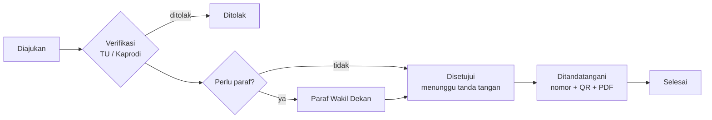

# SIPERSU FT-UMB

**Sistem Informasi Persuratan Fakultas Teknik Universitas Muhammadiyah Buton.**

Aplikasi web untuk mengurus seluruh siklus surat fakultas: pengajuan surat mahasiswa, surat keluar, surat masuk, penomoran sesuai pedoman, persetujuan pimpinan, tanda tangan elektronik ber-QR yang dapat diverifikasi, dan buku agenda. Berjalan **lokal dan offline** di satu komputer Windows (Laragon); tidak butuh internet untuk pemakaian harian.

Laravel 12 · Livewire 4 · Alpine.js · Tailwind CSS (dikompilasi sekali) · SQLite

---

## Daftar isi

1. [Apa yang dikerjakan sistem](#1-apa-yang-dikerjakan-sistem)
2. [Peran pengguna](#2-peran-pengguna)
3. [Alur surat](#3-alur-surat)
4. [Teknologi dan struktur proyek](#4-teknologi-dan-struktur-proyek)
5. [Menjalankan untuk pengembangan](#5-menjalankan-untuk-pengembangan)
6. [Pemasangan di server (Windows)](#6-pemasangan-di-server-windows)
7. [Konfigurasi `.env`](#7-konfigurasi-env)
8. [Perintah artisan](#8-perintah-artisan)
9. [REST API](#9-rest-api)
10. [Pengujian](#10-pengujian)
11. [Keamanan](#11-keamanan)
12. [Dokumentasi lengkap](#12-dokumentasi-lengkap)
13. [Status dan batasan](#13-status-dan-batasan)

---

## 1. Apa yang dikerjakan sistem

| Modul | Fungsi |
|---|---|
| **e-Layanan mahasiswa** | Mahasiswa mengajukan surat (keterangan aktif kuliah, izin penelitian, pengantar kerja praktik, cuti akademik, rekomendasi beasiswa) lewat formulir tiga langkah, unggah berkas persyaratan (PDF/JPG/PNG, maks 2 MB), melacak status, dan mengunduh PDF setelah terbit |
| **Verifikasi dan persetujuan** | TU atau Kaprodi memverifikasi, Wakil Dekan memaraf (bila jenis surat mengharuskan), Dekan menandatangani. Setiap tahap bisa ditolak atau dikembalikan dengan catatan wajib; semua tercatat di garis waktu |
| **Surat keluar** | Dosen, tendik, dan TU membuat surat dari **format** siap pakai (undangan, surat tugas, pemberitahuan, surat keterangan, pencairan anggaran, dll.) atau surat bebas. Dua bentuk: **ber-QR** (tanda tangan elektronik) dan **tanpa QR** (cetak, tanda tangan basah, cap) |
| **Surat masuk** | TU mencatat surat dari luar dengan nomor agenda otomatis (`AGD-2026/X/0004`), sifat (biasa, penting, segera, rahasia), dan pindaian |
| **Pembukuan** | Buku agenda tunggal berdasarkan nomor surat: surat masuk, keluar, dan surat lama (catat manual atau **impor CSV**), dengan ekspor CSV |
| **Penomoran** | Mengikuti Pedoman Tata Naskah Dinas UM Buton: `{urut}/{kekhususan}/II.3.AU/{unit kerja}/{pokok masalah}/{tahun}`, contoh `007/KET/II.3.AU/UMB-06.2/F/2026`. Otomatis atau diisi manual oleh TU; tidak pernah ganda |
| **Tanda tangan elektronik** | Tanda tangan digital Ed25519 oleh pemegang jabatan penandatangan; QR pada surat; hash SHA-256 PDF disimpan. Halaman verifikasi memeriksa keaslian |
| **Format Surat** | TU membuat atau mengubah jenis surat **tanpa pemrograman**: isian (teks, tanggal, angka, pilihan, daftar, tabel), templat isi, aturan alur, seruan, pokok masalah |
| **Master Data** | Pengguna (termasuk impor CSV), program studi, jabatan dan pejabat, klasifikasi surat, seruan, spesimen tanda tangan dan stempel |
| **Pengaturan** | Pola nomor, kop surat, log aktivitas, backup |
| **Notifikasi** | Di dalam aplikasi, dan opsional lewat email |
| **Backup** | ZIP terenkripsi AES-256 harian, uji pemulihan, arsip semester |
| **REST API** | API baca saja dengan token Bearer untuk integrasi (lihat [bagian 9](#9-rest-api)) |

---

## 2. Peran pengguna

| Peran | Tugas utama |
|---|---|
| **Mahasiswa** | Mengajukan, melacak, mengunduh surat |
| **Dosen / Tendik** | Membuat surat keluar |
| **Kaprodi** | Memverifikasi pengajuan mahasiswa prodinya sendiri; melihat surat masuk non-rahasia |
| **Wakil Dekan** | Memaraf; melihat surat masuk dan Pembukuan |
| **Dekan** | Menandatangani surat; melihat surat masuk dan Pembukuan |
| **Admin TU** | Verifikasi, nomor surat, surat masuk, Pembukuan, Format Surat, Master Data, spesimen, pengaturan, backup |
| **Super Admin** | Seperti Admin TU; **tidak dapat menandatangani** |

Satu akun boleh memegang beberapa peran. Hanya **pemegang jabatan penandatangan aktif** (mis. Dekan) yang dapat menandatangani; Admin TU dan Super Admin sengaja tidak bisa.

---

## 3. Alur surat

**Pengajuan mahasiswa**



- Nomor surat terbit **saat tanda tangan**, tidak lebih awal.
- Jenis surat yang diatur **tanpa QR dan tanpa persetujuan** langsung terbit setelah TU memverifikasi.
- Setiap jenis surat punya tenggat layanan (SLA) dalam hari kerja.

**Surat keluar staf:** draf → (paraf opsional) → tanda tangan → terbit; atau **tanpa QR**: terbit langsung dengan PDF kosong untuk tanda tangan basah dan cap. Surat terbit tidak dihapus, tetapi **dibatalkan** dengan alasan.

**Verifikasi QR:** QR memuat alamat halaman verifikasi + data surat + tanda tangan digital. Halaman statis memeriksanya di peramban pemindai; petugas TU memakai halaman lengkap (`/v/{token}`) untuk melihat status batal dan mencocokkan hash PDF.

---

## 4. Teknologi dan struktur proyek

| Lapisan | Pilihan |
|---|---|
| Kerangka | Laravel 12, PHP 8.2+ |
| Antarmuka | Blade, Livewire 4, Alpine.js, Tailwind CSS 3 (hasil kompilasi di `public/css/app.css`, ikut di-commit) |
| Basis data | SQLite (`database/sipersu.sqlite`) |
| Hak akses | spatie/laravel-permission + Policy |
| PDF dan QR | barryvdh/laravel-dompdf, simplesoftwareio/simple-qrcode |
| Kriptografi | Ed25519 (libsodium), SHA-256, ZIP AES-256 untuk backup |
| API | Laravel Sanctum (token Bearer) |
| Server | Apache + PHP lewat Laragon, Windows 10/11 |

Semua aset (font Plus Jakarta Sans dan Inter, ikon Material Symbols sebagai SVG inline, Chart.js, Alpine) disimpan lokal. **Tidak ada CDN.**

```
app/
  Http/Controllers/        Pengajuan, Persetujuan, SuratKeluar/Masuk, Pembukuan, FormatSurat, Master, Backup, ...
  Http/Controllers/Api/    REST API v1 (baca saja)
  Livewire/                Login, formulir pengajuan surat
  Services/                Aturan bisnis: AlurPengajuan, AlurSuratKeluar, PenomoranService,
                           TandaTanganService, KunciTte, PenyusunSurat, PembukuanService, Backup, ...
  Models/  Policies/  Enums/  Support/
config/sipersu.php         Pengaturan khas aplikasi (kunci TTE, URL verifikasi, jaringan lokal, lampiran, backup)
database/                  Migrasi dan seeder (peran, pengguna contoh, master data, format surat bawaan, data demo)
documentation/             Panduan, dokumentasi sistem, API, presentasi, contoh surat
resources/views/           Tampilan; pdf/ berisi kop, isi, blok tanda tangan, lembar riwayat
routes/                    web.php, api.php, console.php (jadwal)
scripts/                   Skrip .bat untuk Windows: pasang, jalankan, backup, ubah URL, scheduler
template/img/              Kop, logo, spesimen tanda tangan
tests/                     Uji otomatis
```

---

## 5. Menjalankan untuk pengembangan

Prasyarat: PHP 8.2+ dengan ekstensi `sodium`, `pdo_sqlite`, `gd`, `mbstring`, `intl`, `zip`; Composer.

```bash
composer install
cp .env.example .env && php artisan key:generate
touch database/sipersu.sqlite
php artisan migrate --seed
php artisan kunci:buat          # pasangan kunci tanda tangan elektronik (sekali)
php artisan kunci:publikasi     # halaman verifikasi statis
php artisan serve
```

Buka `http://127.0.0.1:8000` (atau `APP_URL` Anda). Akun contoh, kata sandi `password` untuk semuanya (**hanya untuk uji**):

| Peran | Login |
|---|---|
| Super Admin | `superadmin` |
| Admin TU | `TU` |
| Dekan | `0912038401` |
| Wakil Dekan | `0912048102` |
| Kaprodi (TS / RSK / STI) | `0912058301` / `0912068502` / `0912078603` |
| Dosen / Tendik | `0912088704` |
| Mahasiswa | `21650012` |

Daftar lengkap dan aturan kata sandi: [AKUN-DAN-PASSWORD.md](AKUN-DAN-PASSWORD.md).

**Data demo** untuk menguji tampilan (pengajuan di berbagai status, surat terbit, surat masuk): `php artisan db:seed --class=DemoSeeder` lalu `DemoSuratMasukSeeder`. **Jangan di produksi.**

**Mengubah tampilan** (Node.js hanya untuk ini, bukan untuk menjalankan aplikasi):

```bash
npm install
npm run assets   # salin font, ikon SVG, Chart.js, Alpine, logo ke folder proyek
npm run build    # kompilasi Tailwind → public/css/app.css (di-commit)
npm run watch    # kompilasi otomatis saat mengedit
```

---

## 6. Pemasangan di server (Windows)

Panduan lengkap untuk non-programmer ada di **[INSTALL.md](INSTALL.md)**: Laragon, `scripts\pasang.bat`, IP statis, firewall, nama lokal `sipersu.ft.umbuton.ac.id`, anti-sleep, Task Scheduler, backup 3-2-1, HTTPS opsional, dan SOP.

Ringkasnya:

1. Pasang Laragon (Apache + PHP 8.2+), salin proyek ke `C:\laragon\www\sipersu`, arahkan Document Root ke `public`.
2. Klik dua kali `scripts\pasang.bat` (migrasi, data awal, kunci TTE, halaman verifikasi).
3. `scripts\ubah-url.bat` memilih alamat server; `scripts\buka-firewall.bat` dan `scripts\daftarkan-scheduler.bat` (jalankan sebagai Administrator).
4. **Sebelum dipakai sungguhan:** ganti semua kata sandi akun contoh, isi pejabat/prodi/klasifikasi asli, unggah spesimen tanda tangan dan stempel, simpan salinan kunci (`php artisan kunci:cadangkan D:\kunci-sipersu`).

**Memperbarui server yang sudah berjalan:** backup dulu (**Pengaturan → Backup**), ganti kode, lalu `composer install`, `php artisan migrate --force`, `php artisan config:cache`.

---

## 7. Konfigurasi `.env`

Contoh lengkap ada di [.env.example](.env.example). Yang paling penting:

| Variabel | Fungsi |
|---|---|
| `APP_URL` | Alamat server. Diatur lewat `scripts\ubah-url.bat`. QR pada surat yang sudah terbit tetap menuju alamat saat surat itu terbit, jadi pilih alamat yang stabil |
| `APP_FORCE_HTTPS` | `true` hanya bila memakai HTTPS |
| `APP_DEBUG` | **Harus `false` di server** |
| `VERIFIKASI_URL` | Alamat halaman verifikasi statis. Kosong = `{APP_URL}/verifikasi`. Isi bila halaman diunggah ke hosting luar (mis. GitHub Pages) |
| `LAN_CIDRS` | Rentang IP yang boleh mengakses aplikasi (bawaan: loopback, IP privat, Tailscale). Selain itu 403 |
| `BACKUP_PASSWORD` | Sandi ZIP backup. **Hilang = backup tidak bisa dibuka siapa pun** |
| `BACKUP_LOCAL_PATH` | Folder backup harian (HDD eksternal), mis. `D:\backup-sipersu` |
| `BACKUP_RCLONE_REMOTE` | Opsional: tujuan Google Drive via rclone, mis. `gdrive:sipersu-backup` |
| `MAIL_*` | Opsional: email notifikasi. Tanpa ini notifikasi tetap tampil di aplikasi |
| `API_TOKEN_MENIT` | Masa berlaku token REST API dalam menit (bawaan 10080 = 7 hari) |
| `LAJU_AKTIF`, `LAJU_PER_MENIT`, `LAJU_BLOKIR_DETIK` | Pembatas banjir akses per IP (bawaan 300 permintaan/menit; lewat 2× batas = blokir 300 detik). Lihat [bagian 11](#11-ketahanan-dan-keamanan) |

Pengaturan yang diubah lewat aplikasi (bukan `.env`): pola nomor, mode penomoran (otomatis/manual), kode unit fakultas, kota surat, dan kop surat di **Pengaturan → Format Nomor**.

---

## 8. Perintah artisan

| Perintah | Fungsi |
|---|---|
| `php artisan kunci:buat` | Membuat pasangan kunci Ed25519 (`--force` menimpa: **berbahaya**) |
| `php artisan kunci:cadangkan <folder>` | Menyalin kunci ke tempat aman |
| `php artisan kunci:publikasi` | Membuat `verifikasi-statis/index.html` (memuat kunci publik) |
| `php artisan tte:periksa <tautan QR>` | Memeriksa isi QR dari baris perintah |
| `php artisan backup:run --jenis=harian` | Backup terenkripsi (`manual`, `harian`, `mingguan`; `--tujuan=` untuk folder lain) |
| `php artisan backup:list` / `backup:verify` | Riwayat dan pemeriksaan checksum/ZIP |
| `php artisan backup:restore <zip> [--uji-saja]` | Pemulihan, atau uji pemulihan tanpa menimpa data |
| `php artisan backup:periksa` | Memeriksa kesehatan backup |
| `php artisan dokumentasi:contoh-surat` | Membuat ulang PDF contoh surat (tidak mengubah basis data) |
| `php artisan dokumentasi:qrcode` / `dokumentasi:presentasi-qr` | Membuat PDF penjelasan QR dan slide presentasi QR |
| `php artisan simulasi:siapkan` | Menyiapkan data simulasi untuk latihan |
| `php artisan sipersu:periksa` | Pemeriksaan kesehatan: basis data, migrasi, kunci TTE, folder, disk, backup. Kode keluar 1 bila kritis (dijadwalkan tiap jam) |
| `php artisan banjir:buka <ip>` / `--semua` | Membuka blokir sementara pembatas banjir akses |

Jadwal otomatis (lewat satu tugas Windows tiap menit, `routes/console.php`): antrean email tiap menit, **pemeriksaan kesehatan tiap jam**, backup harian 16.30, backup Google Drive Jumat 17.30 (dilewati bila tanpa internet), pembersihan antrean gagal mingguan.

---

## 9. REST API

API **baca saja** untuk integrasi dengan sistem lain, di `/api/v1`. Autentikasi token Bearer pribadi; hak akses **sama dengan aplikasi web** (peran, prodi, kerahasiaan surat). Hanya dapat dipanggil dari jaringan lokal.

```bash
# 1. buat token (tampil sekali)
curl -X POST http://sipersu.ft.umbuton.ac.id/api/v1/auth/token \
  -H "Accept: application/json" -H "Content-Type: application/json" \
  -d '{"nomor_induk":"TU","password":"********","nama_perangkat":"dasbor"}'

# 2. pakai token
curl http://sipersu.ft.umbuton.ac.id/api/v1/pengajuan?status=diajukan \
  -H "Accept: application/json" -H "Authorization: Bearer <token>"
```

| Endpoint | Fungsi |
|---|---|
| `POST/DELETE /auth/token`, `GET /me` | Membuat, mencabut token; identitas pemilik |
| `GET /jenis-surat[/{kode}]` | Katalog format surat, isian, syarat berkas |
| `GET /pengajuan[/{kode}]` | Pengajuan surat dan persetujuannya |
| `GET /surat-keluar[/{id}]`, `GET /surat-masuk[/{id}]` | Surat keluar dan masuk |
| `GET /pembukuan` | Buku agenda |
| `GET /verifikasi/{token}` | Memeriksa keaslian surat ber-QR |

Pemasangan: `php artisan migrate` (tabel token). Rincian, contoh respons, dan klien contoh: **[documentation/api-rest.md](documentation/api-rest.md)**; spesifikasi OpenAPI: [documentation/openapi.yaml](documentation/openapi.yaml).

---

## 10. Pengujian

```bash
php artisan test                              # seluruh uji (233 uji)
php artisan test tests/Feature/ApiV1Test.php  # satu berkas
```

Uji memakai basis data SQLite di memori dan mencakup: alur pengajuan dan tahapan surat, penomoran (otomatis dan mandiri), tanda tangan dan verifikasi QR, pratinjau dan cetak, Format Surat, surat masuk, Pembukuan, impor pengguna, spesimen, akses dan otorisasi, backup dan pemulihan, serta REST API, pembatas banjir akses, pemeriksaan kesehatan, dan **uji asap** yang membuka semua halaman web sebagai tiap peran untuk mencegah halaman rusak.

---

## 11. Ketahanan dan keamanan

| Kontrol | Penjelasan |
|---|---|
| Akses jaringan | Hanya IP loopback, privat, dan Tailscale; selain itu 403 (middleware `AksesJalur`, berlaku juga untuk API) |
| **Banjir akses** | Pembatas per IP (`BatasiBanjir`): lewat 300 permintaan/menit dijawab `429` (`Retry-After`), lewat 600 diblokir 5 menit. Dihitung di cache berkas **sebelum sesi dan SQLite disentuh**, sehingga banjir tidak mengunci basis data. Uji beban 1000 permintaan: 300 dilayani, 700 ditolak, server tetap hidup. `/up` tidak dibatasi |
| Deteksi dini | `sipersu:periksa` tiap jam; masalah kritis (basis data rusak, kunci TTE hilang, migrasi tertunda, disk hampir penuh) dikirim ke Admin |
| Login | NPM/NIDN/username + kata sandi ter-hash; 5 kali salah dalam semenit memblokir sementara |
| Tanda tangan | Hanya pemegang jabatan penandatangan; wajib konfirmasi kata sandi akun; seluruh penerbitan dalam satu transaksi |
| Otorisasi | Diperiksa ulang di server menurut peran, prodi, dan status surat |
| Berkas | Lampiran dan PDF disimpan di folder privat, diunduh lewat rute yang dicek haknya |
| Kunci | Kunci privat tidak pernah keluar dari server selain di backup terenkripsi dan salinan kunci |
| Jejak audit | Log aktivitas, riwayat persetujuan, lembar riwayat dokumen pada PDF |

**Bila aplikasi mati, dibanjiri, atau gagal diperbarui,** ikuti [documentation/pemulihan.md](documentation/pemulihan.md): skenario dan langkah kembali (rollback pembaruan, basis data rusak, kunci hilang, disk penuh, laptop rusak), target data hilang paling banyak sehari (backup harian 16.30), dan daftar periksa rutin.

Yang **tidak** dilindungi: QR membuktikan keaslian dan keutuhan, **bukan kerahasiaan isi surat**; lampiran dan PDF tidak dienkripsi di disk (lindungi server, mis. BitLocker). Penjelasan lengkap: [cara-kerja-tanda-tangan-elektronik.md](documentation/cara-kerja-tanda-tangan-elektronik.md).

---

## 12. Dokumentasi lengkap

Semua di folder [documentation/](documentation/):

| Dokumen | Untuk |
|---|---|
| [panduan-pengguna.md](documentation/panduan-pengguna.md) | Pengguna: langkah demi langkah per peran, dengan tangkapan layar |
| [dokumentasi-sistem.md](documentation/dokumentasi-sistem.md) | Pimpinan dan pengelola: alur, penomoran, keamanan, arsitektur, operasional |
| [api-rest.md](documentation/api-rest.md), [openapi.yaml](documentation/openapi.yaml) | Pengembang integrasi |
| [pemulihan.md](documentation/pemulihan.md) | Pengelola: banjir akses, aplikasi mati, rollback, backup dan pemulihan |
| [cara-kerja-tanda-tangan-elektronik.md](documentation/cara-kerja-tanda-tangan-elektronik.md) | Kunci, QR, tanda tangan digital, batasan |
| Presentasi: [PowerPoint](documentation/presentasi-sipersu.pptx), [PDF](documentation/presentasi-sipersu.pdf), [web](documentation/presentasi-sipersu.html) | Bahan presentasi 18 slide (versi web dibuka di peramban, tanpa internet) |
| [format-csv-pengguna.md](documentation/format-csv-pengguna.md), [format-csv-pembukuan.md](documentation/format-csv-pembukuan.md) | Format berkas impor beserta contoh `.csv` |
| [contoh-surat/](documentation/contoh-surat/README.md) | 15 pasang contoh PDF surat (ber-QR dan tanpa QR) |
| [../INSTALL.md](INSTALL.md), [../AKUN-DAN-PASSWORD.md](AKUN-DAN-PASSWORD.md) | Pemasangan di Windows; akun contoh |

Aset gambar kop, logo, dan spesimen tanda tangan: [template/img/](template/img/).

---

## 13. Status dan batasan

**Sudah berjalan:** semua modul pada [bagian 1](#1-apa-yang-dikerjakan-sistem).

**Belum aktif:** Disposisi surat masuk, Arsip digital, dan Laporan. Kerangka menu dan sebagian struktur data sudah disiapkan, tetapi fiturnya belum dibuka.

**Batasan Fase 1:**

- Server hanya terbuka di jaringan kampus. QR dipindai dari perangkat yang tersambung ke jaringan itu; halaman verifikasi statis dapat dipublikasikan ke hosting gratis bila nanti perlu dipindai dari luar.
- REST API hanya membaca; tidak ada endpoint untuk mengajukan atau menandatangani surat, dan tidak ada unduhan PDF/lampiran lewat API.
- Satu server, satu basis data SQLite; keandalan bergantung pada backup 3-2-1 dan uji pemulihan berkala.
