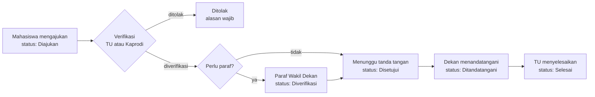
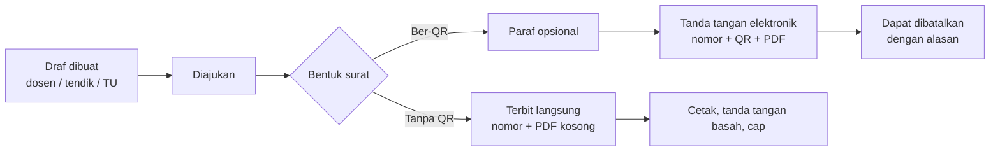
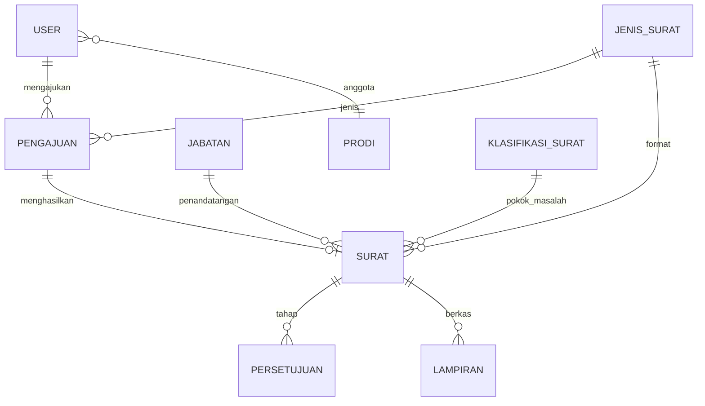

# Dokumentasi Sistem SIPERSU FT-UMB

Sistem Informasi Persuratan Fakultas Teknik Universitas Muhammadiyah Buton.

Dokumen ini menjelaskan **apa yang dikerjakan sistem, siapa yang memakainya, bagaimana alur suratnya, dan bagaimana sistem dijaga**. Ditujukan untuk pimpinan fakultas, Tata Usaha, dan pengelola teknis.

| Mau tahu | Baca |
|---|---|
| Cara memakai aplikasi (per peran, langkah demi langkah) | [panduan-pengguna.md](panduan-pengguna.md) |
| Memasang di Windows (Laragon, jaringan, backup) | [../INSTALL.md](../INSTALL.md) |
| Akun contoh dan aturan kata sandi | [../AKUN-DAN-PASSWORD.md](../AKUN-DAN-PASSWORD.md) |
| Cara kerja tanda tangan elektronik dan QR | [cara-kerja-tanda-tangan-elektronik.md](cara-kerja-tanda-tangan-elektronik.md) |
| Format berkas impor (CSV) | [format-csv-pengguna.md](format-csv-pengguna.md), [format-csv-pembukuan.md](format-csv-pembukuan.md) |
| Contoh PDF surat yang diterbitkan | [contoh-surat/](contoh-surat/README.md) |
| Bahan presentasi | [presentasi-sipersu.pptx](presentasi-sipersu.pptx), [PDF](presentasi-sipersu.pdf), [web](presentasi-sipersu.html) |
| Integrasi dengan sistem lain (REST API) | [api-rest.md](api-rest.md), [openapi.yaml](openapi.yaml) |
| Aplikasi mati, banjir akses, rollback, pemulihan | [pemulihan.md](pemulihan.md) |

---

## 1. Ringkasan

SIPERSU menggantikan proses surat yang selama ini berjalan di kertas dan chat: pengajuan surat mahasiswa, pembuatan surat keluar, pencatatan surat masuk, penomoran, persetujuan pimpinan, hingga pembuktian keaslian surat.

**Tiga hal yang dikerjakan sistem**

1. **e-Layanan mahasiswa.** Mahasiswa mengajukan surat (keterangan aktif kuliah, izin penelitian, pengantar KP, cuti akademik, rekomendasi beasiswa), melacak statusnya, dan mengunduh PDF setelah terbit.
2. **Persuratan staf.** Tata Usaha dan dosen/tendik membuat surat keluar dari format yang sudah disiapkan, TU mencatat surat masuk, dan seluruh surat masuk-keluar tercatat di buku agenda (Pembukuan).
3. **Tanda tangan elektronik dan verifikasi.** Surat ber-QR ditandatangani pejabat secara digital. Siapa pun yang memindai QR dapat memeriksa keasliannya.

**Prinsip rancangan**

| Prinsip | Wujudnya |
|---|---|
| Berjalan lokal dan offline | Satu laptop/PC server Windows di fakultas, tanpa internet untuk pemakaian harian |
| Akses hanya dari jaringan kampus | Alamat IP di luar jaringan privat ditolak (403) |
| Nomor surat sesuai pedoman | Mengikuti Pedoman Tata Naskah Dinas UM Buton |
| Setiap tindakan tercatat | Log aktivitas, riwayat persetujuan, garis waktu per surat |
| Mudah diurus non-programmer | Format surat, master data, dan pengaturan diubah dari menu, bukan dari kode |

---

## 2. Pengguna dan peran

Ada tujuh peran. Satu akun dapat memegang lebih dari satu peran.

| Peran | Tugas utama di sistem |
|---|---|
| **Mahasiswa** | Mengajukan surat, melacak status, mengunduh surat terbit |
| **Dosen / Tendik** | Membuat surat keluar (diajukan ke pejabat), melihat surat buatannya |
| **Kaprodi** | Memverifikasi pengajuan mahasiswa **prodinya sendiri** (untuk jenis surat yang verifikatornya Kaprodi), memaraf/menandatangani bila jabatannya ditunjuk, melihat surat masuk non-rahasia |
| **Wakil Dekan** | Memaraf surat yang memerlukan paraf, melihat surat masuk dan Pembukuan |
| **Dekan** | Menandatangani surat (penandatangan "Dekan"), melihat surat masuk dan Pembukuan |
| **Admin Tata Usaha** | Memverifikasi pengajuan, membuat surat keluar, mencatat surat masuk, mengisi nomor surat, mengelola Pembukuan, Format Surat, Master Data, spesimen tanda tangan, pengaturan, dan backup |
| **Super Admin** | Seperti Admin TU, ditambah dapat bertindak pada tahap persetujuan bila diperlukan. **Tidak dapat menandatangani** |

### Menu menurut peran

| Menu | Mahasiswa | Dosen/Tendik | Kaprodi | Wakil Dekan | Dekan | Admin TU / Super Admin |
|---|:-:|:-:|:-:|:-:|:-:|:-:|
| Dasbor | ✔ | ✔ | ✔ | ✔ | ✔ | ✔ |
| Pengajuan Surat, Lacak Status, Riwayat | ✔ | | | | | |
| Layanan Mahasiswa (daftar pengajuan) | | | ✔ | | | ✔ |
| Persetujuan & TTD | | | ✔ | ✔ | ✔ | Super Admin saja |
| Surat Masuk | | | ✔ | ✔ | ✔ | ✔ |
| Surat Keluar | | ✔ | ✔ | ✔ | ✔ | ✔ |
| Pembukuan | | | | ✔ (lihat) | ✔ (lihat) | ✔ (catat, impor) |
| Format Surat, Alur Surat, Master Data, Pengaturan | | | | | | ✔ |

Menu Disposisi, Arsip, dan Laporan sudah dipersiapkan pada kerangka menu tetapi **belum aktif** (lihat bagian 11).

---

## 3. Alur surat

### 3.1 Pengajuan surat mahasiswa



Enam status pengajuan: **Diajukan → Diverifikasi → Disetujui → Ditandatangani → Selesai**, atau **Ditolak**.

- Pada tahap paraf atau tanda tangan, pejabat dapat **mengembalikan untuk revisi** (catatan wajib). Pengajuan kembali ke tahap verifikasi.
- Nomor surat **baru terbit saat tanda tangan**, tidak pernah lebih awal dan tidak pernah ganda.
- Jika sebuah jenis surat diatur **tanpa QR dan tanpa persetujuan**, surat **langsung terbit** (nomor dan PDF) begitu TU memverifikasi.
- Setiap jenis surat punya tenggat layanan (SLA) dalam hari kerja. Tenggat dihitung saat pengajuan.

**Lima jenis surat mahasiswa bawaan**

| Surat | Diverifikasi | Paraf | Penandatangan | SLA |
|---|---|---|---|---|
| Surat Keterangan Aktif Kuliah | Admin TU | – | Dekan | 2 hari |
| Surat Izin Penelitian | Admin TU | Wakil Dekan | Dekan | 3 hari |
| Surat Pengantar Kerja Praktik | Kaprodi (prodi pemohon) | – | Dekan | 3 hari |
| Surat Cuti Akademik | Kaprodi (prodi pemohon) | Wakil Dekan | Dekan | 5 hari |
| Surat Rekomendasi Beasiswa | Admin TU | Wakil Dekan | Dekan | 3 hari |

Semua aturan di atas dapat diubah TU lewat menu **Alur Surat** (khusus alur) atau **Format Surat** (bersama isian dan templat) tanpa menyentuh kode.

**Menu Alur Surat** menampilkan tahapan tiap format sebagai diagram dan menyediakan formulir ubah singkat: bentuk (ber-QR/tanpa QR), pemverifikasi, penandatangan, paraf, dan target hari kerja. Aturan penyelarasan sama dengan Format Surat (`JenisSurat::rapikanAlur`): tanpa QR berarti tanpa paraf, dan pemverifikasi selain Admin TU hanya berlaku untuk layanan mahasiswa. Selama ada pengajuan berjalan pada suatu format, bentuk, pemverifikasi, dan paraf dikunci; penandatangan yang diganti ikut memperbarui tahap tanda tangan yang masih menunggu. Setiap perubahan dicatat di Log Aktivitas (`alur_ubah`).

### 3.2 Surat keluar staf



Status surat keluar: **draf → menunggu paraf (opsional) → menunggu tanda tangan → ditandatangani**, atau **batal**. Surat yang sudah terbit tidak dihapus; ia **dibatalkan** dengan alasan, dan halaman verifikasinya menampilkan status batal.

**Dua bentuk surat**

| | Surat ber-QR (TTE) | Surat tanpa QR |
|---|---|---|
| Pengesahan | Tanda tangan elektronik pejabat | Tanda tangan basah dan cap |
| Persetujuan di aplikasi | Paraf (opsional) lalu tanda tangan pejabat | Tidak ada, langsung terbit |
| PDF | 2 halaman: surat + Lembar Riwayat Dokumen, memuat QR dan spesimen tanda tangan + stempel | 1 halaman, ruang tanda tangan dan stempel dikosongkan |
| Nomor | Terbit saat tanda tangan | Terbit saat tombol **Terbitkan Surat** |
| Verifikasi publik | Ya | Tidak |

Pembuat surat memilih bentuknya di awal; bawaan mengikuti format surat.

### 3.3 Surat masuk

TU memilih jenis surat masuk (Umum, Undangan, Permohonan/Audiensi), mengisi nomor dan asal surat, tanggal surat, tanggal diterima, perihal, dan **sifat** (biasa, penting, segera, rahasia), lalu mengunggah **pindaian** surat. Sistem memberi **nomor agenda** otomatis (`AGD-2026/X/0004`). Surat **rahasia** hanya terlihat oleh Admin, Dekan, dan Wakil Dekan.

### 3.4 Pembukuan (buku agenda)

Satu buku untuk semua surat berdasarkan **nomor surat**: surat masuk, surat keluar yang terbit di aplikasi, dan surat lama yang dicatat atau diimpor dari CSV. Dapat disaring dan diekspor ke CSV; perihal surat rahasia disamarkan bagi selain Admin TU.

---

## 4. Penomoran surat

Pola bawaan (dapat diubah di **Pengaturan → Format Nomor**) mengikuti Pedoman Tata Naskah Dinas UM Buton:

```
{urut}/{kekhususan}/II.3.AU/{unit kerja}/{pokok masalah}/{tahun}
 007  /  KET      /II.3.AU/ UMB-06.2  /      F       / 2026
```

| Bagian | Sumber |
|---|---|
| `urut` | Penghitung per **unit kerja per tahun takwim**; hanya bertambah, nomor yang dibatalkan tidak dipakai ulang |
| `kekhususan` | Kode "seruan" pada format surat (KET, TGS, REK, EDR, …); kosong untuk surat biasa. Dikelola di Master Data → Seruan |
| `unit kerja` | Program studi penandatangan (bila punya kode unit), selain itu kode fakultas `UMB-06` |
| `pokok masalah` | Klasifikasi A–O pada format surat (mis. F = Pendidikan, Penelitian, dan Latihan) |

**Dua cara penomoran** (Pengaturan → Format Nomor)

- **Otomatis (bawaan):** nomor dibuat sistem saat surat terbit, di dalam transaksi basis data sehingga dua penandatanganan bersamaan tidak pernah mendapat nomor sama.
- **Manual (diisi TU):** TU mengetik nomor **sebelum** surat berjalan. Boleh hanya angka urut (`9`, sisanya disusun otomatis) atau nomor lengkap. Nomor bentrok dengan surat lain atau catatan Pembukuan **ditolak**. Nomor yang sudah terbit tidak bisa diubah.

Nomor agenda surat masuk berbentuk `AGD-{tahun}/{bulan romawi}/{urut}`.

Pratinjau sebelum terbit menampilkan `000` sebagai penanda posisi nomor; nomor sebenarnya muncul saat surat terbit.

---

## 5. Tanda tangan elektronik dan verifikasi

Ringkasan (penjelasan lengkap: [cara-kerja-tanda-tangan-elektronik.md](cara-kerja-tanda-tangan-elektronik.md)):

- Fakultas memiliki **satu pasang kunci Ed25519**. Kunci privat hanya ada di server (`storage/keys/ed25519.secret`); kunci publik tertanam di halaman verifikasi.
- Saat pejabat menekan **Setujui & Tanda Tangani** (dan memasukkan kata sandi akun), server: menerbitkan nomor, membuat token acak, menandatangani ringkasan data surat, membuat QR, merender PDF, dan menyimpan **hash SHA-256** PDF final. Semuanya dalam satu transaksi; gagal satu, batal semua.
- **QR berisi** alamat halaman verifikasi + data ringkas + tanda tangan digital. Yang terjamin adalah **keaslian dan keutuhan**, bukan kerahasiaan isi surat.

**Dua halaman verifikasi**

| Halaman | Untuk | Fungsi |
|---|---|---|
| Verifikasi statis (`/verifikasi`) | Siapa saja yang memindai QR | Memeriksa tanda tangan di peramban, tanpa server dan tanpa basis data |
| Verifikasi lengkap (`/v/{token}`) | Petugas TU di jaringan lokal | Status aktif/batal, riwayat dokumen, dan **pencocokan hash** dengan mengunggah PDF |

Batasan yang perlu diketahui: pada Fase 1 server hanya terbuka di jaringan kampus, sehingga QR dipindai dari perangkat yang tersambung ke jaringan itu. Halaman verifikasi statis dapat diunggah ke hosting gratis (mis. GitHub Pages) bila nanti QR perlu dapat dipindai dari luar kampus. QR pada surat yang sudah terbit tetap menuju alamat saat surat itu terbit.

---

## 6. Format Surat (dikelola TU tanpa pemrograman)

Menu **Format Surat** menentukan *surat untuk apa*:

1. **Identitas:** nama, kegunaan, dan **dibuat oleh** siapa: *surat keluar (staf)*, *surat masuk (dicatat TU)*, atau *mahasiswa (e-Layanan)*.
2. **Isian:** kolom yang harus diisi: teks, teks panjang, tanggal, angka, pilihan, **daftar** (mis. Tembusan, dicetak bernomor), dan **tabel** (baris berulang dengan kolom sendiri, mis. Nama | Program Studi).
3. **Templat isi surat:** isi surat dengan token isian yang disisipkan lewat tombol. Tersedia pratinjau dengan data contoh dan penanda posisi tanda tangan.
4. **Aturan alur:** pemverifikasi, perlu paraf atau tidak (dan oleh siapa), penandatangan (jabatan), tenggat, bentuk bawaan (ber-QR atau tanpa QR), gaya tanggal (Masehi atau Masehi + Hijriah).
5. **Penomoran:** seruan (kode kekhususan), pokok masalah (A–O), dan posisi nomor pada surat.
6. **Syarat berkas** untuk format mahasiswa, serta pindaian untuk format surat masuk.

Format dapat dinonaktifkan atau disalin tanpa menghapus surat yang sudah terbit darinya.

**Sembilan format staf dan tiga format surat masuk bawaan**

Surat Undangan, Surat Tugas, Surat Tugas Rekomendasi, Surat Pemberitahuan, Surat Keterangan Aktif Kuliah, Surat Keterangan Cuti Akademik, Surat Keterangan Aktif Kembali Setelah Cuti, Surat Permohonan Pencairan Anggaran, Surat Izin Penelitian (dibuat TU). Surat masuk: Umum, Undangan, Permohonan/Audiensi. Contoh PDF-nya ada di [contoh-surat/](contoh-surat/README.md).

---

## 7. Data dan arsitektur

### 7.1 Teknologi

| Lapisan | Pilihan |
|---|---|
| Kerangka | Laravel 12 (PHP 8.2+) |
| Antarmuka | Blade, Livewire 4 (formulir pengajuan), Alpine.js, Tailwind CSS (dikompilasi sekali dan disimpan di `public/css/app.css`) |
| Basis data | SQLite, satu berkas `database/sipersu.sqlite` |
| Peran dan hak akses | spatie/laravel-permission, ditambah Policy per model |
| REST API | Laravel Sanctum (token Bearer), baca saja; lihat [api-rest.md](api-rest.md) |
| PDF | barryvdh/laravel-dompdf |
| QR | simplesoftwareio/simple-qrcode |
| Kriptografi | Ed25519 (libsodium bawaan PHP), SHA-256, AES-256 untuk backup |
| Server | Apache + PHP lewat Laragon di Windows 10/11 |

**REST API v1** (`routes/api.php`, `app/Http/Controllers/Api`) membuka data baca saja (pengajuan, surat keluar/masuk, Pembukuan, verifikasi QR) untuk aplikasi lain. Hak aksesnya sama dengan aplikasi web, tanpa endpoint tulis, dan hanya dapat dipanggil dari jaringan lokal. Pemasangan: `php artisan migrate` (tabel token).

Semua aset (font, ikon, Chart.js, Alpine) disimpan lokal. Tidak ada CDN. Node.js hanya diperlukan untuk mengubah tampilan, bukan untuk menjalankan aplikasi.

### 7.2 Struktur kode

| Folder | Isi |
|---|---|
| `app/Http/Controllers` | Pengajuan, Persetujuan, Surat Keluar/Masuk, Pembukuan, Format Surat, Master, Pengaturan, Backup, Verifikasi, dll. |
| `app/Livewire` | Login dan formulir pengajuan surat bertahap |
| `app/Services` | **Aturan bisnis**: `AlurPengajuan`, `AlurSuratKeluar`, `PenomoranService`, `TandaTanganService`, `KunciTte`, `PenyusunSurat`, `PembukuanService`, `SuratMasukService`, `Backup`, `Notifikator`, `ImporPengguna` |
| `app/Models` | `Pengajuan`, `Surat`, `Persetujuan`, `JenisSurat` (format surat), `Jabatan`, `Prodi`, `KlasifikasiSurat`, `Seruan`, `Pembukuan`, `Lampiran`, `Notifikasi`, `LogAktivitas`, `Pengaturan`, `Penomoran`, `User` |
| `app/Policies` | Siapa boleh melihat pengajuan dan surat |
| `app/Support` | `Menu` (menu per peran), `NomorManual`, `TahunAkademik`, `TanggalHijriah`, `MasterData`, `Csv` |
| `resources/views` | Tampilan per fitur; `pdf/` berisi kop, isi, blok tanda tangan, lembar riwayat |
| `database/seeders` | Peran, pengguna contoh, master data, format surat bawaan, data demo |
| `scripts/` | Berkas `.bat` pemasangan, backup, scheduler, ubah URL |
| `tests/` | Uji otomatis (`php artisan test`) untuk alur, penomoran, TTE, impor, backup, akses |

### 7.3 Data utama



- **Surat** menyimpan surat keluar dan masuk (kolom `arah`), nomor, status, mode tanda tangan (QR atau tanpa), token QR, hash PDF, dan alasan batal.
- **Persetujuan** mencatat tiap tahap (verifikasi, paraf, ttd): siapa, kapan, keputusan, catatan.
- **Penomoran** menyimpan penghitung per unit per tahun.
- **LogAktivitas** mencatat tindakan penting beserta pengguna dan alamat IP.

---

## 8. Keamanan dan kontrol

| Kontrol | Penjelasan |
|---|---|
| Banjir akses | Pembatas per IP: lewat 300 permintaan/menit dijawab 429, lewat 600 diblokir 5 menit; dihitung sebelum sesi dan basis data disentuh. Lihat [pemulihan.md](pemulihan.md) |
| Akses jaringan | Hanya IP loopback, privat (10.x, 172.16–31.x, 192.168.x), dan Tailscale yang diterima; selain itu 403. Dapat diatur lewat `LAN_CIDRS` |
| Masuk | NPM / NIDN / username + kata sandi. Salah 5 kali dalam 1 menit memblokir sementara. Kata sandi disimpan ter-hash |
| Kata sandi | Minimal 8 karakter, huruf dan angka (saat mengganti sendiri) |
| Tanda tangan | Hanya **pemegang jabatan penandatangan aktif**; Super Admin dan Admin TU tidak bisa. Wajib konfirmasi kata sandi akun |
| Otorisasi | Setiap tindakan dicek ulang di server menurut peran, prodi (Kaprodi hanya prodinya), dan status surat |
| Berkas | Lampiran PDF/JPG/PNG maksimal 2 MB, diunduh lewat rute yang dicek hak aksesnya |
| Surat rahasia | Disembunyikan dari Kaprodi dan diredam di Pembukuan bagi selain Admin TU |
| Verifikasi | Pembatasan laju (60 permintaan/menit untuk tampil, 20/menit untuk cek berkas) |
| Jejak audit | Log aktivitas (Pengaturan → Log Aktivitas), riwayat persetujuan, lembar riwayat dokumen pada PDF |
| Kunci | Kunci privat tidak pernah keluar dari server selain di backup terenkripsi dan salinan kunci yang disimpan di tempat aman |

---

## 9. Operasional

### 9.1 Tugas terjadwal

Satu tugas Windows (Task Scheduler) berjalan **tiap menit** dan menjalankan jadwal berikut:

| Jadwal | Tugas |
|---|---|
| Tiap menit | Mengirim email antrean (opsional; tanpa email, notifikasi tetap tampil di aplikasi) |
| Harian 16.30 | Backup ke HDD eksternal (menyimpan 30 terakhir) |
| Jumat 17.30 | Backup ke Google Drive via rclone (opsional, dilewati bila tanpa internet) |
| Mingguan | Membersihkan catatan antrean gagal lama |

### 9.2 Backup 3-2-1

3 salinan, 2 jenis media, 1 di luar lokasi: data aktif di server, HDD eksternal (harian), flashdisk arsip semester yang disimpan di brankas Dekanat. Google Drive menjadi salinan tambahan opsional.

Isi backup: salinan SQLite yang konsisten, folder `storage/app` (berkas dan PDF), `storage/keys`, dan `.env`; dibungkus **ZIP terenkripsi AES-256** dengan checksum SHA-256. Menu **Pengaturan → Backup** menyediakan tombol *Backup Sekarang*, unduhan, dan riwayat. Dasbor Admin mengingatkan **uji pemulihan** tiap 30 hari.

### 9.3 Perintah yang sering dipakai

| Perintah | Fungsi |
|---|---|
| `php artisan kunci:buat` | Membuat pasangan kunci tanda tangan (sekali saat pemasangan) |
| `php artisan kunci:cadangkan D:\kunci-sipersu` | Menyalin kunci ke tempat aman |
| `php artisan kunci:publikasi` | Membuat ulang halaman verifikasi statis |
| `php artisan backup:run --jenis=harian` | Backup sekarang |
| `php artisan backup:verify` / `backup:restore --uji-saja` | Memeriksa dan menguji pemulihan |
| `php artisan dokumentasi:contoh-surat` | Membuat ulang PDF contoh surat |
| `scripts\ubah-url.bat` | Mengganti alamat server tanpa menyunting `.env` |

Rincian pemasangan, DNS lokal, firewall, dan SOP backup ada di [INSTALL.md](../INSTALL.md).

---

## 10. Pengujian

Uji otomatis dijalankan dengan `php artisan test` dan mencakup: alur pengajuan dan tahapan surat, penomoran (otomatis dan mandiri), tanda tangan dan verifikasi QR, pratinjau dan cetak, format surat, surat masuk, Pembukuan, impor pengguna, spesimen, akses dan otorisasi, serta backup dan pemulihan.

---

## 11. Cakupan saat ini dan rencana

**Sudah berjalan:** e-Layanan mahasiswa; surat keluar (ber-QR dan tanpa QR); surat masuk dengan nomor agenda dan pindaian; Pembukuan dengan impor/ekspor CSV; Format Surat; Master Data (pengguna, prodi, jabatan dan pejabat, klasifikasi, seruan, spesimen tanda tangan); penomoran sesuai pedoman; verifikasi QR; notifikasi; log aktivitas; backup terenkripsi.

**Belum aktif:** Disposisi surat masuk, Arsip digital, dan Laporan. Menu dan sebagian struktur data sudah disiapkan, tetapi fiturnya belum dibuka untuk pengguna.

**Hal yang perlu diputuskan sebelum dipakai sungguhan:** mengganti semua kata sandi akun contoh; mengisi data pejabat, prodi, dan klasifikasi yang asli; mengunggah spesimen tanda tangan dan stempel pejabat; memilih alamat server yang stabil sebelum menerbitkan surat ber-QR; menyimpan salinan kunci di tempat aman.

---

## 12. Istilah

| Istilah | Arti |
|---|---|
| TTE | Tanda tangan elektronik |
| Paraf | Persetujuan awal sebelum tanda tangan (mis. Wakil Dekan) |
| Spesimen | Gambar tanda tangan dan stempel pejabat yang dicetak pada surat ber-QR |
| Seruan | Kode kekhususan pada nomor surat (KET, TGS, REK, …) |
| Pokok masalah | Klasifikasi surat A–O pada nomor surat |
| Hash | "Sidik jari" berkas; berubah total bila isi berkas berubah |
| SLA | Tenggat layanan dalam hari kerja |
