# Panduan Pengguna SIPERSU FT-UMB

Panduan langkah demi langkah memakai Sistem Informasi Persuratan Fakultas Teknik UM Buton. Cari bagian sesuai peran Anda.

| Saya adalah… | Baca bagian |
|---|---|
| Mahasiswa | [2](#2-mahasiswa-mengajukan-dan-melacak-surat) |
| Dosen / tenaga kependidikan | [3](#3-dosen--tendik-membuat-surat-keluar) |
| Admin Tata Usaha | [4](#4-admin-tata-usaha) |
| Kaprodi | [5](#5-kaprodi) |
| Wakil Dekan | [6](#6-wakil-dekan-memaraf) |
| Dekan | [7](#7-dekan-menandatangani) |
| Super Admin / pengelola teknis | [8](#8-super-admin-dan-pengelola-sistem) |
| Penerima surat yang ingin memeriksa keaslian | [9](#9-memeriksa-keaslian-surat-qr) |

Dokumen terkait: [dokumentasi-sistem.md](dokumentasi-sistem.md) (gambaran sistem), [../INSTALL.md](../INSTALL.md) (pemasangan).

---

## 1. Dasar-dasar untuk semua pengguna

### 1.1 Membuka aplikasi

Buka alamat yang diberikan Tata Usaha di peramban (Chrome, Edge, atau Firefox), misalnya `http://sipersu.ft.umbuton.ac.id`. Aplikasi hanya dapat dibuka dari **jaringan Wi-Fi/LAN kampus**. Dari luar kampus Anda akan melihat pesan *"Aplikasi ini hanya dapat diakses dari jaringan lokal fakultas"* (403).

Bila nama tidak terbuka, coba alamat cadangan berupa angka IP (`http://192.168.1.10`) yang diberikan TU. Bila tetap gagal, matikan *Private DNS* (Android) atau *Secure DNS* (Chrome/Edge) di perangkat Anda.

### 1.2 Masuk

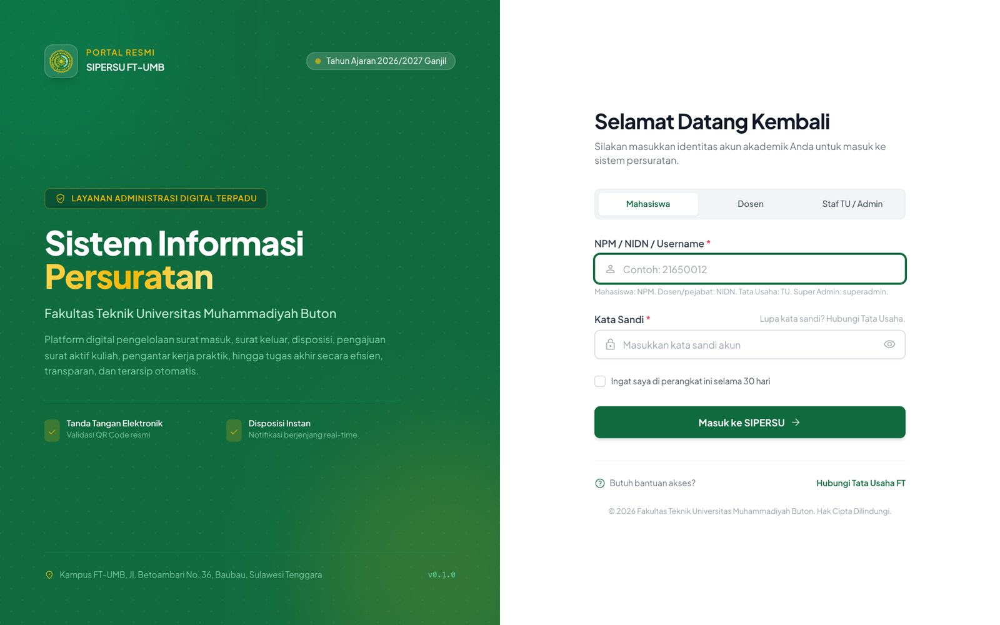

1. Pilih tab **Mahasiswa**, **Dosen**, atau **Staf TU / Admin** sesuai Anda.
2. Isi **NPM / NIDN / Username** (huruf besar-kecil tidak dibedakan) dan **kata sandi**.
3. Klik **Masuk ke SIPERSU**.

Salah memasukkan kata sandi 5 kali dalam 1 menit memblokir login sementara; tunggu sebentar lalu coba lagi. **Lupa kata sandi atau belum punya akun:** hubungi Tata Usaha (Senin–Jumat, 08.00–15.30 WITA).

### 1.3 Mengganti kata sandi

Klik nama Anda di pojok kanan atas → **Profil Saya → Ganti Kata Sandi**. Isi kata sandi lama, lalu kata sandi baru (minimal 8 karakter, mengandung huruf dan angka). **Ganti kata sandi bawaan pada login pertama.**

### 1.4 Notifikasi

Ikon lonceng di pojok kanan atas menampilkan tugas dan kabar terbaru (pengajuan baru, menunggu paraf, surat terbit, ditolak). Klik pemberitahuan untuk langsung membuka halaman terkait. Bila email diaktifkan oleh TU, pemberitahuan juga dikirim ke email.

### 1.5 Arti status

| Status | Artinya |
|---|---|
| **Diajukan** | Menunggu pemeriksaan TU atau Kaprodi |
| **Diverifikasi** | Lolos pemeriksaan, menunggu paraf pimpinan |
| **Disetujui** | Menunggu tanda tangan |
| **Ditandatangani** | Surat terbit, nomor sudah ada, PDF dapat diunduh |
| **Selesai** | Pengajuan ditutup oleh TU |
| **Ditolak** | Ditolak; alasan tertera di halaman pengajuan |

---

## 2. Mahasiswa: mengajukan dan melacak surat

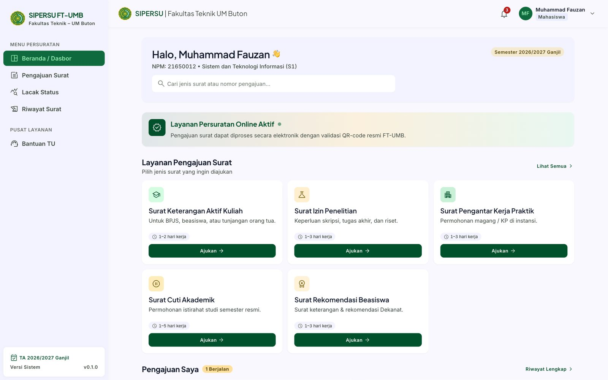

Menu mahasiswa: **Beranda / Dasbor**, **Pengajuan Surat**, **Lacak Status**, **Riwayat Surat**, dan **Bantuan TU**.

### 2.1 Mengajukan surat

1. Klik **Pengajuan Surat**. Pilih jenis surat; setiap kartu menunjukkan perkiraan waktu proses. Kolom pencarian membantu mencari jenis surat.

   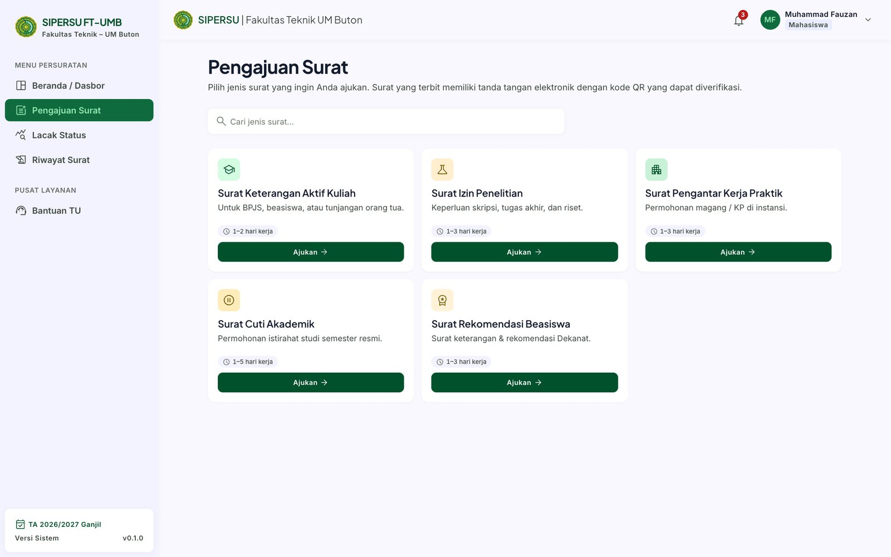

2. Klik **Ajukan**. Formulir terdiri dari tiga langkah:
   - **Data akademik:** data profil Anda terisi otomatis dari akun (bila ada yang salah, minta TU memperbaiki akun Anda). Di langkah ini Anda juga mengisi **data detail surat** sesuai jenisnya (misalnya semester, tahun akademik, instansi tujuan, judul penelitian). Tanda **\*** berarti wajib.
   - **Berkas persyaratan:** unggah berkas yang diminta (KTM, bukti SPP, KRS, dan sebagainya). Format **PDF, JPG, atau PNG, maksimal 2 MB** per berkas.
   - **Ringkasan dan kirim:** periksa kembali, lalu kirim.

   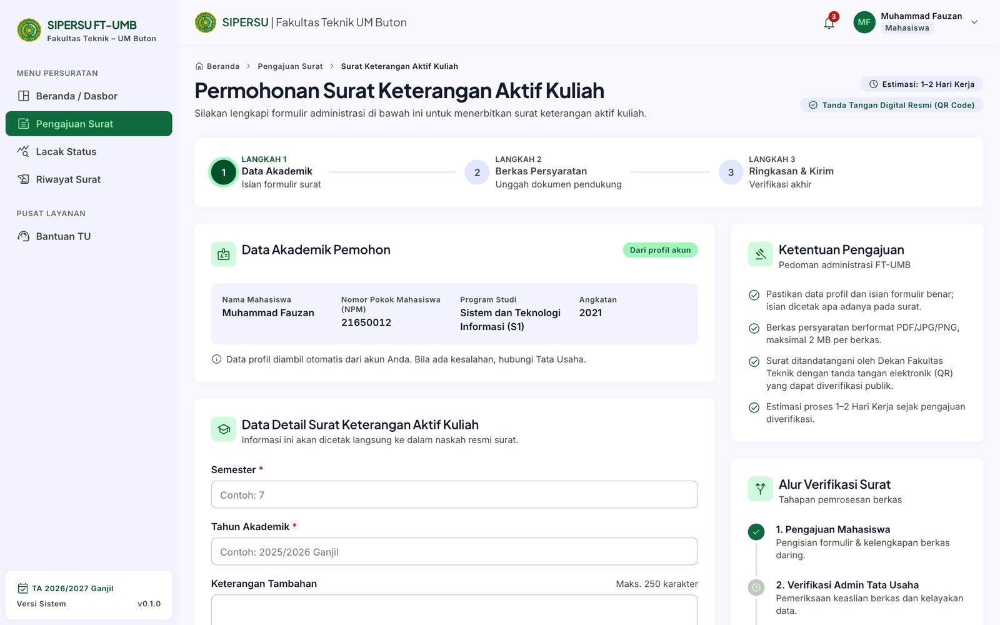

3. Setelah terkirim, Anda mendapat **nomor registrasi** (contoh `REG-2026-000002`). Catat nomor ini.

### 2.2 Melacak status

Klik **Lacak Status** (atau masukkan nomor registrasi di kolom pencarian). Halaman menunjukkan posisi pengajuan: tahap saat ini, siapa yang sedang memeriksa, dan perkiraan selesai.

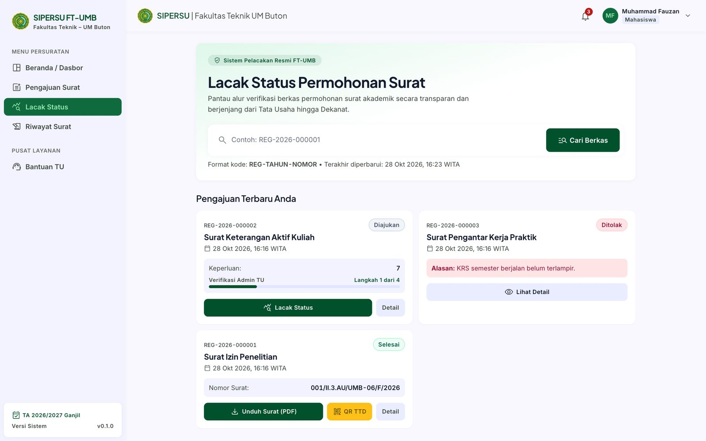

Klik **Detail** untuk melihat garis waktu lengkap, catatan verifikator, dan, bila ditolak, **alasan penolakan**. Perbaiki sesuai alasan lalu ajukan kembali.

### 2.3 Mengunduh surat

Setelah status **Ditandatangani**, halaman pengajuan menampilkan **Surat Resmi Telah Diterbitkan**:

- **Unduh Surat (PDF)** untuk mencetak.
- **Verifikasi QR** untuk melihat halaman keaslian surat.

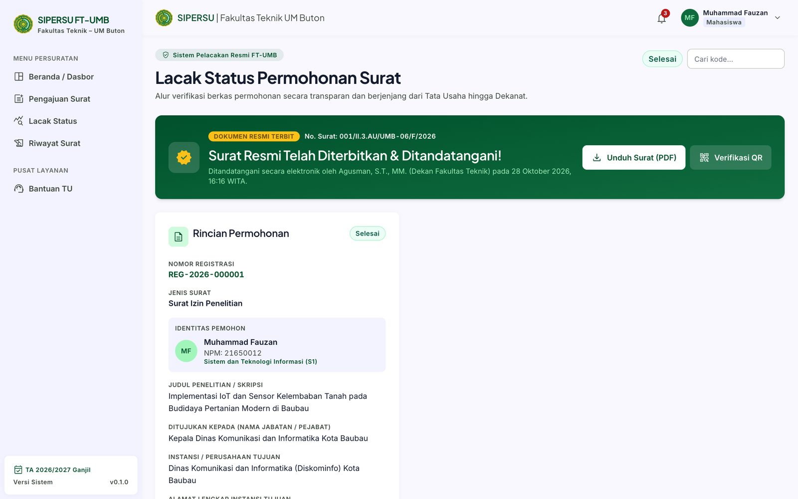

Cetak PDF di kertas A4. Ada dua jenis surat:

- **Surat ber-QR:** sudah memuat tanda tangan dan stempel elektronik. Cukup cetak.
- **Surat tanpa QR:** ruang tanda tangan dikosongkan. **Bawa ke TU/pejabat untuk ditandatangani basah dan dicap.**

**Riwayat Surat** menyimpan semua pengajuan Anda beserta unduhannya.

### 2.4 Pertanyaan umum mahasiswa

| Pertanyaan | Jawaban |
|---|---|
| Berapa lama prosesnya? | Tertera pada kartu jenis surat (mis. 1–2 hari kerja untuk keterangan aktif kuliah). Dihitung hari kerja |
| Pengajuan saya ditolak | Buka Detail, baca alasan, perbaiki berkas/isian, ajukan ulang |
| Berkas gagal diunggah | Pastikan PDF/JPG/PNG dan di bawah 2 MB. Kompres bila perlu |
| Data profil saya salah | Hubungi TU untuk memperbaiki akun |
| Nomor surat belum ada | Nomor baru terbit saat pejabat menandatangani |

---

## 3. Dosen / Tendik: membuat surat keluar

Menu: **Dasbor** dan **Surat Keluar**.

### 3.1 Membuat surat

1. Klik **Surat Keluar** lalu **Buat Surat** (tombol kuning di kanan atas).
2. **Pilih bentuk:**
   - **Surat Ber-QR:** ditandatangani elektronik oleh pejabat dan dapat diverifikasi publik.
   - **Surat Tanpa QR:** dicetak lalu ditandatangani basah dan dicap.

   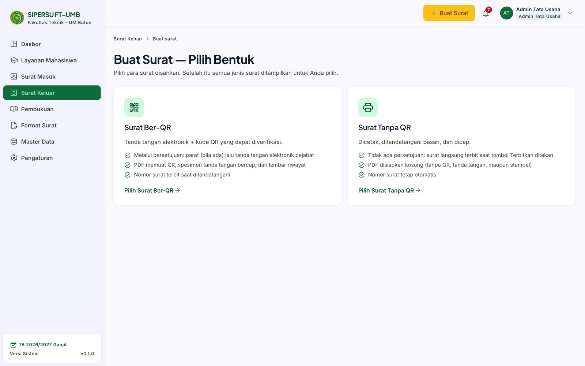

3. **Pilih format** (Surat Undangan, Surat Tugas, Surat Pemberitahuan, dan seterusnya) atau **Surat Bebas** bila tidak ada format yang cocok.
4. **Isi formulir.** Pratinjau surat tampil di sisi kanan dan ikut berubah saat Anda mengetik.
   - **Tanggal surat:** bila tidak diubah, tanggal surat mengikuti hari penandatanganan. Bila Anda memilih tanggal, **tanggal Hijriah langsung tampil** dan dipakai pada surat untuk format yang menyertakannya.
   - Isian **Daftar** (mis. Tembusan): satu entri per baris.
   - Isian **Tabel** (mis. daftar yang ditugaskan): tambah baris sesuai kebutuhan.

   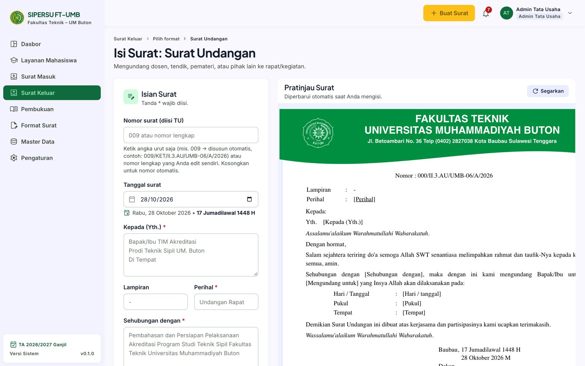

5. Klik **Simpan**. Surat tersimpan sebagai **draf**.

### 3.2 Mengajukan dan memantau

1. Buka draf, periksa pratinjau A4, ubah bila perlu (draf masih dapat diedit).
2. Klik **Ajukan** (surat ber-QR) atau **Terbitkan Surat** (surat tanpa QR).
3. Pantau di bagian **Tahapan Surat** pada halaman surat: draf → paraf (bila ada) → tanda tangan → terbit.
4. **Nomor surat** diisi oleh Admin TU sebelum surat terbit. Bila penomoran manual aktif dan nomor belum diisi, sistem meminta Anda menghubungi TU.
5. Bila pejabat **mengembalikan untuk revisi**, buka surat, baca catatannya, perbaiki, dan ajukan ulang.

Setelah terbit, unduh PDF dari halaman surat. Surat yang sudah terbit tidak dapat diubah; bila salah, minta TU atau penandatangan **membatalkannya** lalu buat surat baru.

### 3.3 Tips mencetak

Saat mencetak dari peramban, matikan **Headers and footers** dan atur margin **None** agar hasil sama dengan PDF. Cara paling aman: unduh PDF lalu cetak dari pembaca PDF.

---

## 4. Admin Tata Usaha

Admin TU memegang paling banyak tugas. Ringkasnya:

| Tugas | Menu |
|---|---|
| Memeriksa dan memverifikasi pengajuan mahasiswa | Layanan Mahasiswa |
| Mengisi nomor surat | Halaman pengajuan / surat keluar |
| Membuat surat keluar | Surat Keluar |
| Mencatat surat masuk | Surat Masuk |
| Mengelola buku agenda | Pembukuan |
| Menyiapkan format surat | Format Surat |
| Mengatur siapa yang memverifikasi, memaraf, dan menandatangani | Alur Surat |
| Mengelola pengguna, prodi, jabatan, klasifikasi, seruan, spesimen | Master Data |
| Nomor, kop surat, log, backup | Pengaturan |

### 4.1 Dasbor

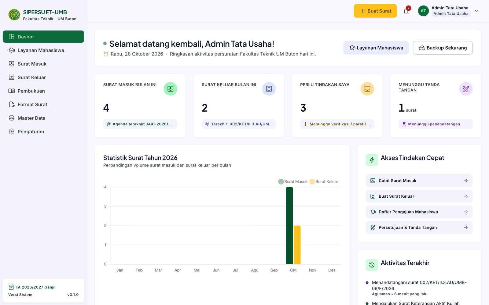

Dasbor menampilkan **surat masuk dan keluar bulan ini**, **perlu tindakan saya**, **menunggu tanda tangan**, grafik tahunan, tombol cepat (catat surat masuk, buat surat keluar, daftar pengajuan, backup), dan **aktivitas terakhir**. Pengingat **uji pemulihan backup** muncul tiap 30 hari.

### 4.2 Memverifikasi pengajuan mahasiswa

1. Klik **Layanan Mahasiswa**. Daftar dapat dicari (nama, NPM, nomor registrasi) dan disaring berdasarkan status. Pengajuan yang butuh Anda ditandai tombol **Periksa / Proses**.

   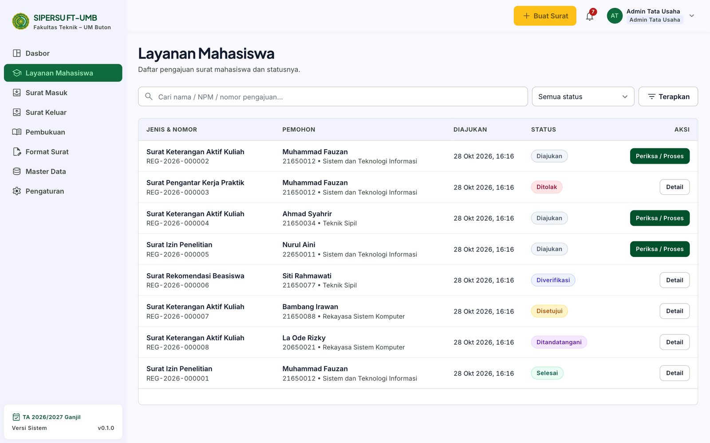

2. Buka pengajuan. Periksa **rincian permohonan**, identitas pemohon, dan **berkas persyaratan** yang diunggah.
3. Pada kotak **Tindakan Anda**:
   - Isi **Nomor surat** (angka urut seperti `9`, atau nomor lengkap), bila TU menerapkan penomoran manual.
   - Isi **catatan verifikasi** (opsional).
   - Klik **Verifikasi & Teruskan**, atau **Tolak Pengajuan**. Alasan penolakan **wajib** dan akan dibaca mahasiswa.

   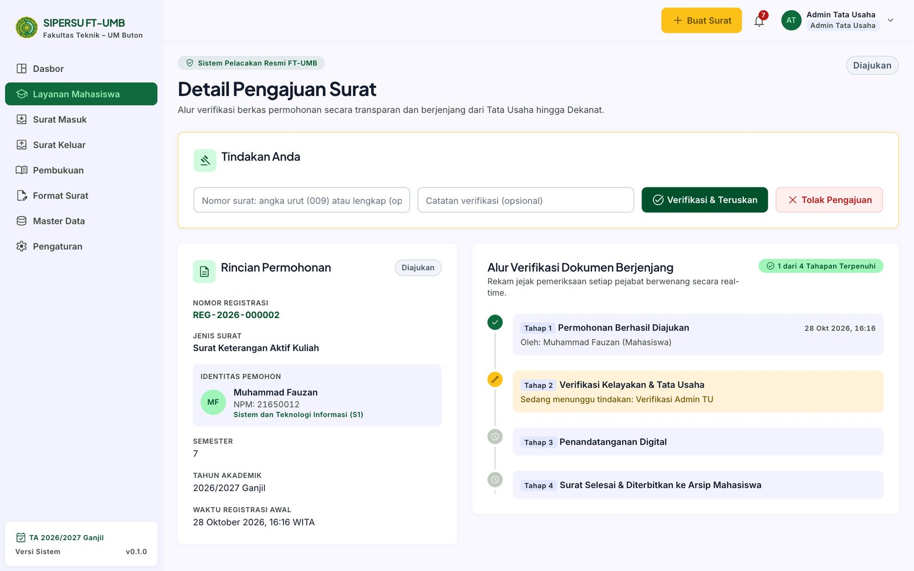

4. Setelah diverifikasi, surat disusun otomatis dari templat, lalu berjalan ke paraf atau tanda tangan sesuai aturan jenis surat. Pada jenis surat **tanpa QR dan tanpa persetujuan**, surat langsung terbit.
5. Setelah pejabat menandatangani dan surat diserahkan/diambil mahasiswa, klik **Selesai** untuk menutup pengajuan.

> Pengajuan jenis tertentu (mis. Kerja Praktik dan Cuti Akademik) diverifikasi oleh **Kaprodi** prodi mahasiswa, bukan TU. TU tetap dapat memantau semuanya.

### 4.3 Membuat surat keluar

Langkahnya sama dengan [bagian 3](#3-dosen--tendik-membuat-surat-keluar). Kelebihan Admin TU:

- Dapat mengisi dan mengubah **Nomor surat** sebelum surat terbit (kolom di formulir dan di halaman surat).
- Dapat mengedit dan mengajukan draf milik orang lain.
- Dapat **membatalkan** surat yang sudah terbit (alasan wajib).

Contoh nomor: ketik `9` pada kolom nomor; sistem menyusun `009/KET/II.3.AU/UMB-06.2/F/2026` sesuai format, unit kerja penandatangan, dan klasifikasi. Nomor yang bentrok dengan surat lain ditolak.

### 4.4 Mencatat surat masuk

1. **Surat Masuk → Catat Surat Masuk**, pilih jenis (Umum, Undangan, Permohonan/Audiensi).

   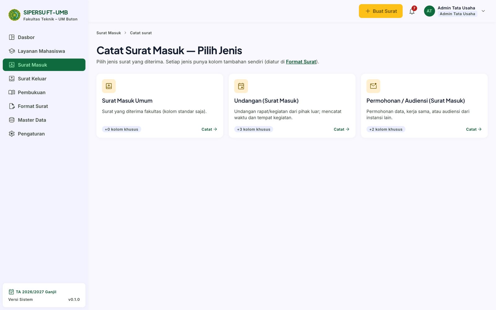

2. Isi **nomor surat asal, asal surat, tanggal surat, tanggal diterima, perihal, sifat** (biasa, penting, segera, rahasia), dan kolom khusus jenisnya. Tanggal diterima tidak boleh sebelum tanggal surat dan tidak boleh di masa depan.
3. Unggah **pindaian** surat (PDF/JPG/PNG).
4. Simpan. Sistem memberi **nomor agenda** otomatis, mis. `AGD-2026/X/0004`.

Daftar surat masuk dapat dicari dan disaring (tahun, sifat, jenis). Surat **rahasia** hanya terlihat oleh Admin, Dekan, dan Wakil Dekan. Hanya Admin yang dapat mengubah catatan.

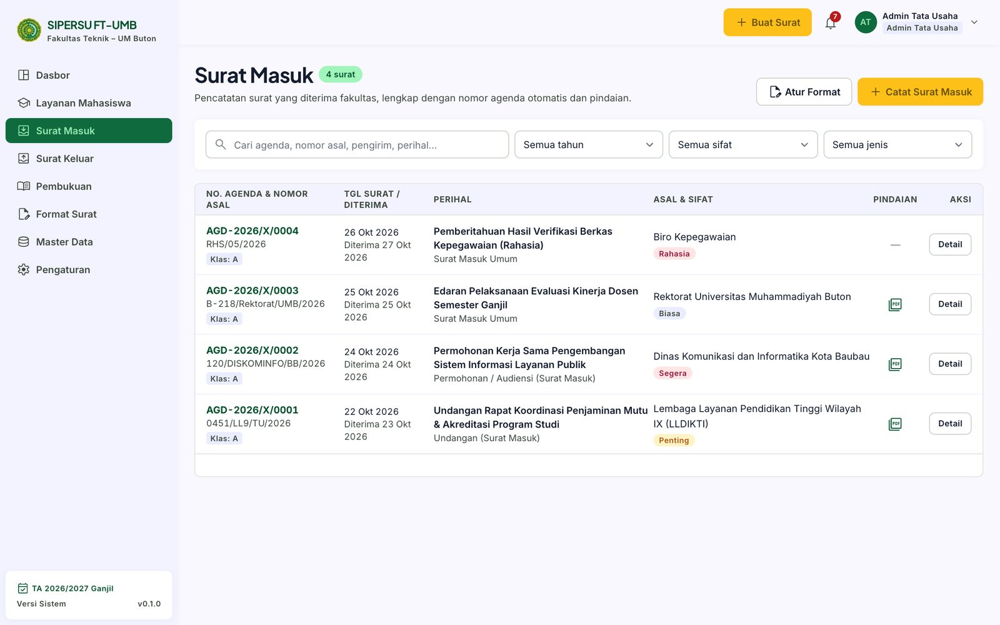

### 4.5 Pembukuan (buku agenda)

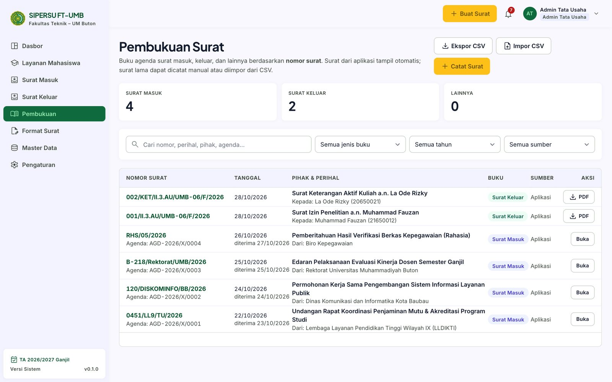

Buku ini memuat **semua surat berdasarkan nomor surat**: surat masuk dan keluar dari aplikasi, serta surat lama yang Anda catat.

- **Catat Surat:** untuk menambah satu surat lama (masuk, keluar, atau lain-lain).
- **Impor CSV:** untuk memasukkan banyak surat lama sekaligus. Unduh **templat**, isi (maksimal 1000 baris), unggah, **periksa** hasilnya, lalu konfirmasi. Nomor kembar dilewati, bukan ditimpa. Format kolom: [format-csv-pembukuan.md](format-csv-pembukuan.md).
- **Ekspor CSV:** mengunduh buku sesuai filter yang aktif.

Pada langkah konfirmasi impor surat keluar, biarkan opsi **menyesuaikan penghitung nomor** tercentang agar nomor otomatis berikutnya melanjutkan nomor tertinggi di CSV.

### 4.6 Format Surat: menentukan surat untuk apa

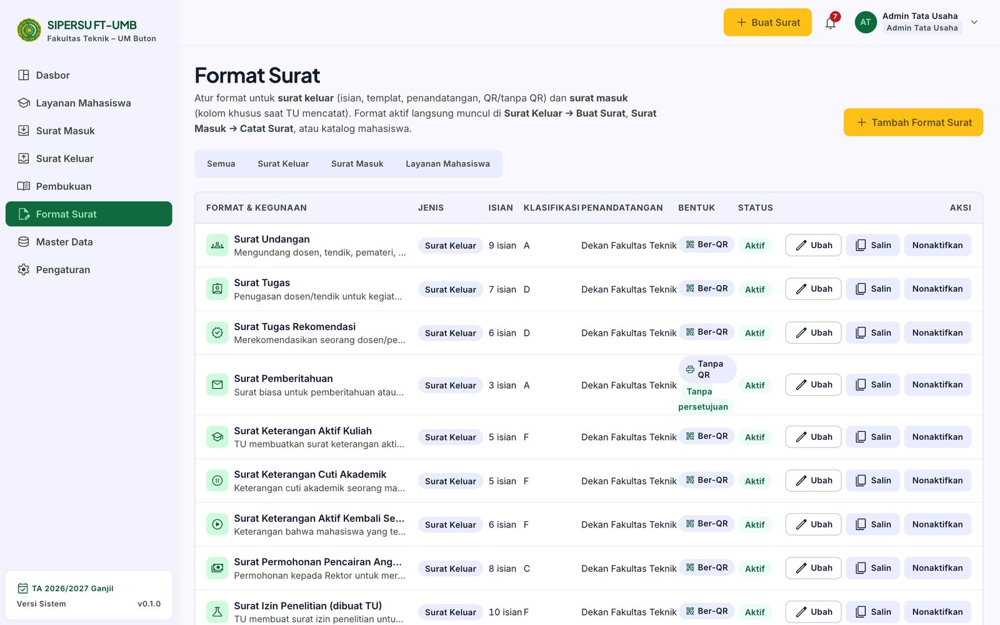

Menu **Format Surat** memungkinkan TU menambah atau mengubah jenis surat tanpa pemrograman.

1. Klik **Tambah Format Surat** (atau **Ubah** pada format yang ada; **Salin** untuk membuat varian).
2. **Surat untuk apa?** Isi nama, kegunaan, dan pilih **Dibuat oleh**: *Surat keluar (staf)*, *Surat masuk (dicatat TU)*, atau *Mahasiswa (e-Layanan)*.

   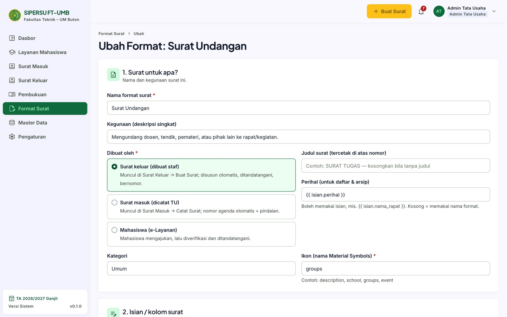

3. **Isian / kolom surat:** klik **Tambah Isian**, beri nama (mis. "Nama Dosen"), pilih jenis (teks, teks panjang, tanggal, angka, pilihan, daftar, tabel) dan wajib atau tidak. Geser untuk mengatur urutan.
4. **Isi surat (templat):** tulis isi surat, lalu klik tombol nama isian untuk menyisipkannya. Tombol **✍ Tanda tangan di sini** menaruh blok tanda tangan di posisi yang Anda mau. **Lihat Pratinjau** menampilkan hasil dengan data contoh.
5. **Aturan alur:** pilih pemverifikasi, apakah perlu paraf (dan oleh siapa), penandatangan, tenggat hari kerja, bentuk bawaan (ber-QR atau tanpa QR), dan gaya tanggal (Masehi atau Masehi + Hijriah).
6. **Penomoran:** pilih **Seruan** (kode kekhususan; kosong = surat biasa) dan **Pokok Masalah** (A–O) untuk nomor surat.
7. Simpan. Format bisa dinonaktifkan kapan saja tanpa memengaruhi surat yang sudah terbit.

### 4.6a Alur Surat: siapa memverifikasi, memaraf, dan menandatangani

Menu **Alur Surat** menampilkan tahapan setiap jenis surat sebagai urutan kotak (misalnya *Pengajuan → Verifikasi → Paraf → Tanda tangan → Terbit*), dikelompokkan menjadi **Layanan Mahasiswa** dan **Surat Keluar**.

1. Klik **Ubah alur** pada jenis surat yang ingin diatur.
2. Pilih **Bentuk surat**: *Ber-QR* (diparaf dan ditandatangani elektronik) atau *Tanpa QR* (langsung terbit untuk dicetak, tanda tangan basah dan cap).
3. Untuk layanan mahasiswa, pilih **Diverifikasi oleh** (Admin TU atau Kaprodi prodi pemohon) dan **Target selesai** dalam hari kerja.
4. Pilih **Penandatangan** (jabatan). Bila jabatan belum punya pejabat aktif, kotak tanda tangan diberi peringatan merah.
5. Centang **Perlu paraf** bila perlu, lalu pilih pemarafnya (Wakil Dekan atau Kaprodi).
6. Klik **Simpan Alur**.

Catatan: selama masih ada pengajuan mahasiswa yang berjalan pada suatu format, bentuk, pemverifikasi, dan paraf tidak dapat diubah (agar pengajuan itu tidak macet); penandatangan dan target waktu tetap bisa diganti. Untuk surat keluar, perubahan berlaku bagi surat yang dibuat sesudahnya. Isian dan templat surat tetap diatur di **Format Surat**.

### 4.7 Master Data

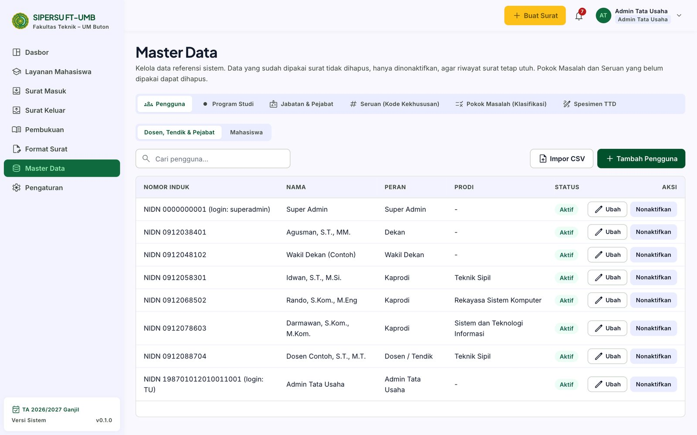

| Tab | Isi |
|---|---|
| Pengguna | Tambah/ubah pengguna dan peran, aktif/nonaktif, atur ulang kata sandi, **Impor CSV** untuk banyak pengguna ([format-csv-pengguna.md](format-csv-pengguna.md)) |
| Program Studi | Nama prodi dan **kode unit kerja** (dipakai pada nomor surat) |
| Jabatan & Pejabat | Siapa pemegang jabatan penandatangan saat ini dan periodenya |
| Seruan | Daftar kode kekhususan nomor surat (KET, TGS, REK, …) |
| Pokok Masalah | Klasifikasi A–O |
| Spesimen TTD | Gambar tanda tangan dan stempel pejabat |

**Saat pejabat berganti,** ubah pemegang jabatan di tab *Jabatan & Pejabat*. Surat berikutnya otomatis memakai pejabat baru.

### 4.8 Spesimen tanda tangan pejabat

Surat ber-QR mencetak spesimen tanda tangan. Buka **Master Data → Spesimen TTD**, pilih pejabat, lalu unggah dua gambar:

- **Tanda tangan + stempel:** dipakai pada surat ber-QR.
- **Tanda tangan saja (tanpa stempel):** cadangan, dipakai bila gambar tanda tangan + stempel belum ada.

Gunakan gambar PNG berlatar transparan agar hasil rapi. Pejabat juga dapat mengunggah sendiri di **Profil**.

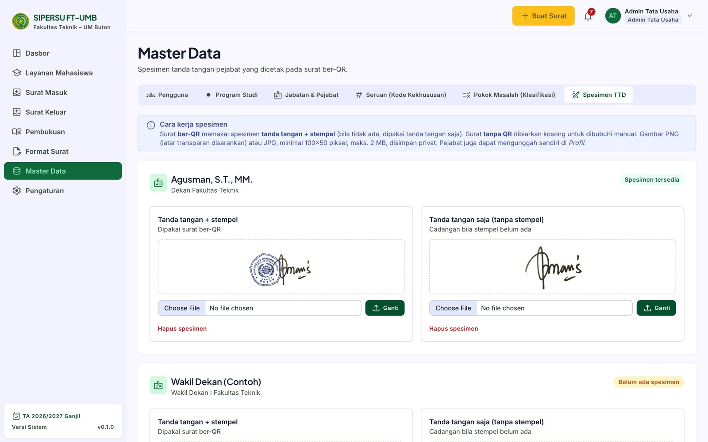

### 4.9 Pengaturan

| Tab | Fungsi |
|---|---|
| **Format Nomor** | Pola nomor surat, **cara penomoran** (otomatis atau manual), kode unit fakultas, kota surat, dan isi kop surat (alamat, email, laman) |
| **Backup** | Tombol **Backup Sekarang**, riwayat backup, unduh arsip |
| **Log Aktivitas** | Jejak tindakan pengguna (siapa, kapan, apa, alamat IP) |

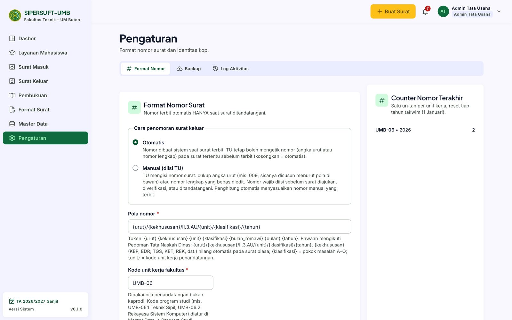

**Rutinitas yang disarankan**

| Kapan | Lakukan |
|---|---|
| Tiap hari | Periksa dasbor: pengajuan baru, surat menunggu tindakan |
| Tiap hari, sore | Pastikan HDD backup terpasang; periksa Pengaturan → Backup berstatus *Sukses* |
| Tiap bulan | Uji pemulihan backup (`scripts\uji-pemulihan.bat`) |
| Akhir semester | Arsip ke flashdisk (`scripts\arsip-semester.bat`), simpan di brankas Dekanat |
| Saat pejabat berganti | Perbarui Jabatan & Pejabat dan unggah spesimen baru |

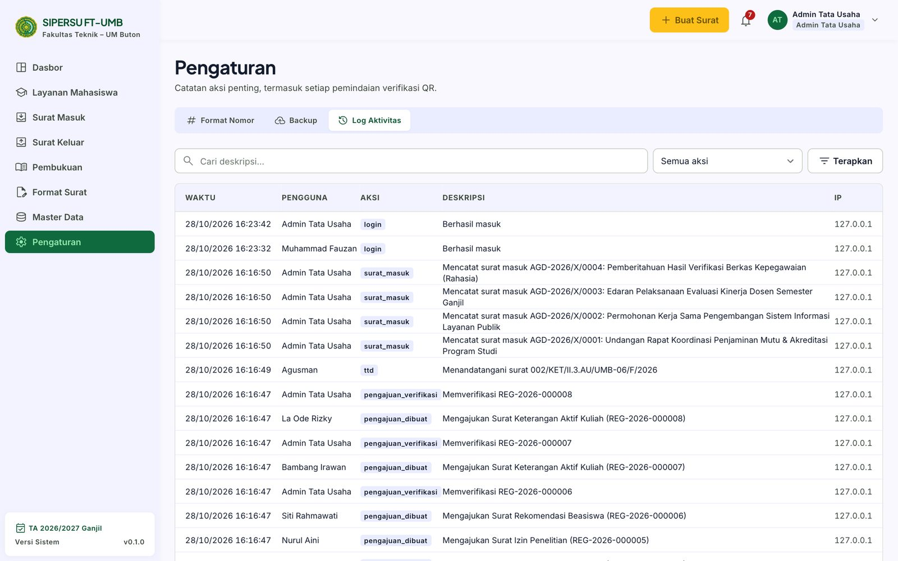

---

## 5. Kaprodi

Menu: **Dasbor**, **Layanan Mahasiswa**, **Persetujuan & TTD**, **Surat Masuk**, **Surat Keluar**.

- **Memverifikasi pengajuan.** Untuk jenis surat yang diverifikasi Kaprodi (mis. Pengantar Kerja Praktik, Cuti Akademik), pengajuan **mahasiswa prodi Anda** muncul di dasbor dan di **Layanan Mahasiswa**. Buka, periksa data dan berkas, lalu **Verifikasi & Teruskan** atau **Tolak** (alasan wajib). Anda tidak dapat memverifikasi pengajuan prodi lain.
- **Surat masuk.** Anda dapat melihat surat masuk yang tidak berstatus rahasia.
- **Surat keluar.** Anda dapat membuat surat keluar seperti dosen/tendik. Bila jabatan Anda ditetapkan sebagai penandatangan atau pemaraf suatu format, surat itu muncul di **Persetujuan & TTD**; langkahnya sama seperti [bagian 6](#6-wakil-dekan-memaraf) dan [7](#7-dekan-menandatangani).

---

## 6. Wakil Dekan: memaraf

Menu: **Dasbor**, **Persetujuan & TTD**, **Surat Masuk**, **Surat Keluar**, **Pembukuan** (lihat saja).

1. Klik **Persetujuan & TTD**. Daftar menampilkan surat yang menunggu paraf Anda. Notifikasi lonceng juga memberi tahu.
2. Buka surat. Halaman memuat **pratinjau surat** yang sama dengan PDF, dan **Rantai Verifikasi Dokumen** (siapa memeriksa apa, kapan).

   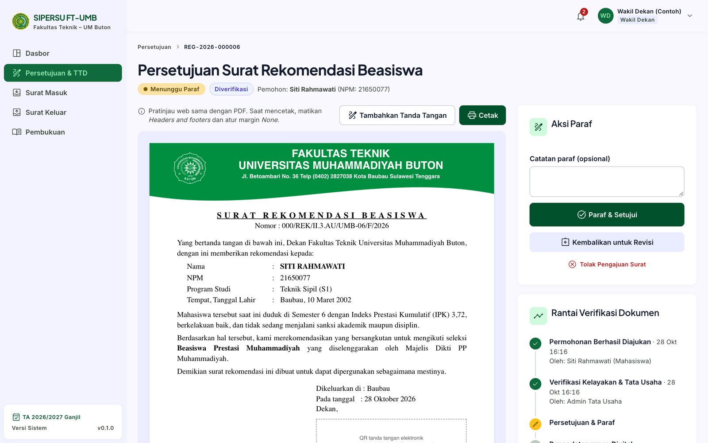

3. Pilih satu:
   - **Paraf & Setujui** (pada surat keluar: **Paraf & Teruskan**): meneruskan surat ke tanda tangan (catatan paraf opsional).
   - **Kembalikan untuk Revisi:** surat kembali ke TU. **Catatan revisi wajib.**
   - **Tolak Pengajuan Surat:** menolak. **Alasan wajib.**

---

## 7. Dekan: menandatangani

Menu: **Dasbor**, **Persetujuan & TTD**, **Surat Masuk**, **Surat Keluar**, **Pembukuan**.

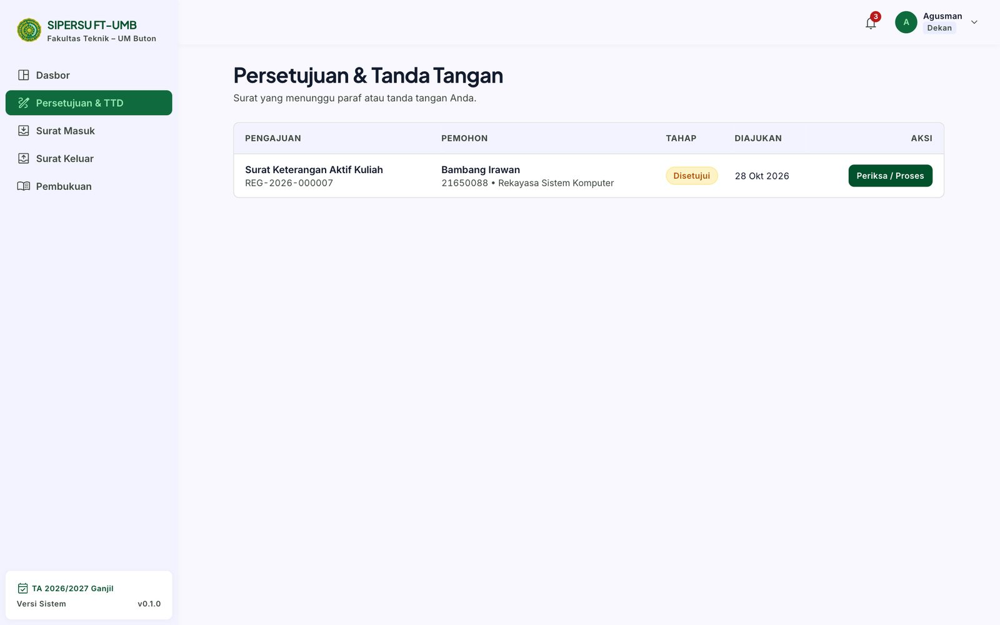

1. Buka **Persetujuan & TTD**. Surat yang sudah diverifikasi dan diparaf (bila perlu) tampil sebagai menunggu tanda tangan.
2. Buka surat dan baca pratinjau dengan teliti. Nomor tampil `000` pada pratinjau; **nomor asli terbit saat Anda menandatangani.**
3. Pada panel **Aksi Pengesahan Pimpinan**, masukkan **kata sandi akun** Anda lalu klik **Setujui & Tanda Tangani (TTE)**.

   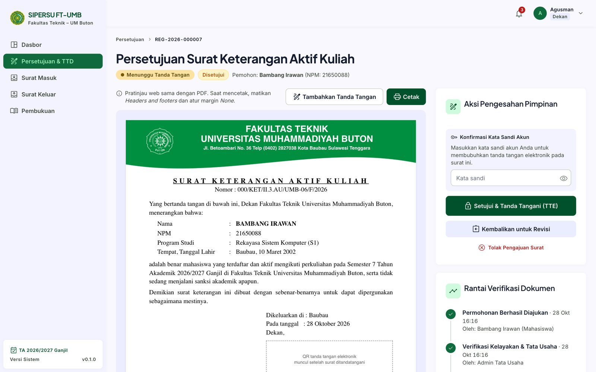

4. Sistem menerbitkan nomor, membuat QR, menandatangani secara digital, dan membuat PDF. Pemohon mendapat pemberitahuan bahwa suratnya terbit.
5. Alternatif: **Kembalikan untuk Revisi** (catatan wajib) atau **Tolak** (alasan wajib).

**Penting**

- Hanya pemegang **jabatan penandatangan aktif** (mis. Dekan) yang dapat menandatangani. Admin TU dan Super Admin **tidak bisa**.
- Tanda tangan elektronik **tidak dapat dibatalkan oleh pembuat surat**. Bila ada kekeliruan setelah terbit, penandatangan atau Admin TU dapat **membatalkan** surat dengan alasan; status batal akan terlihat di halaman verifikasi.
- Pada pratinjau web, tombol **Tambahkan Tanda Tangan / Tanpa Tanda Tangan** menampilkan atau menyembunyikan spesimen tanda tangan sebelum **Cetak**, berguna bila surat akan ditandatangani basah.

---

## 8. Super Admin dan pengelola sistem

Super Admin memiliki seluruh kewenangan Admin TU, dan selain itu dapat bertindak pada tahap persetujuan bila diperlukan. Super Admin **tidak dapat menandatangani** surat.

Tugas khusus pengelola teknis (rincian di [INSTALL.md](../INSTALL.md)):

| Tugas | Cara |
|---|---|
| Mengganti alamat server | `scripts\ubah-url.bat` |
| Menjalankan aplikasi tanpa Laragon | `scripts\jalankan-aplikasi.bat` |
| Backup sekarang | **Pengaturan → Backup → Backup Sekarang** atau `scripts\backup-sekarang.bat` |
| Uji pemulihan | `scripts\uji-pemulihan.bat` |
| Simpan salinan kunci tanda tangan | `php artisan kunci:cadangkan D:\kunci-sipersu` |
| Membuat ulang halaman verifikasi statis | `php artisan kunci:publikasi` |
| Memeriksa apa yang terjadi | **Pengaturan → Log Aktivitas** |

**Daftar periksa sebelum dipakai sungguhan**

- ☐ Ganti kata sandi **semua** akun contoh, atau nonaktifkan.
- ☐ Perbarui nama dan nomor induk pejabat asli, jabatan, prodi, dan klasifikasi.
- ☐ Unggah spesimen tanda tangan dan stempel pejabat.
- ☐ Periksa pola nomor, kota surat, dan kop surat di **Pengaturan → Format Nomor**.
- ☐ Pilih alamat server yang stabil (nama lokal atau IP statis) **sebelum** menerbitkan surat ber-QR.
- ☐ Simpan salinan kunci tanda tangan di tempat aman dan catat sandi backup sesuai SOP.
- ☐ Jalankan satu backup dan satu uji pemulihan.

---

## 9. Memeriksa keaslian surat (QR)

Berlaku untuk siapa saja yang menerima surat ber-QR dari fakultas.

1. Pindai QR pada surat dengan kamera ponsel yang tersambung ke jaringan kampus.
2. Halaman verifikasi terbuka dan memeriksa tanda tangan digital di peramban Anda.
3. Hasil **"Tanda Tangan Elektronik Sah — Dokumen Asli – Terverifikasi"** berarti data pada QR cocok dengan yang ditandatangani fakultas. Cocokkan **nomor surat** dan **perihal** yang tampil dengan surat di tangan Anda.

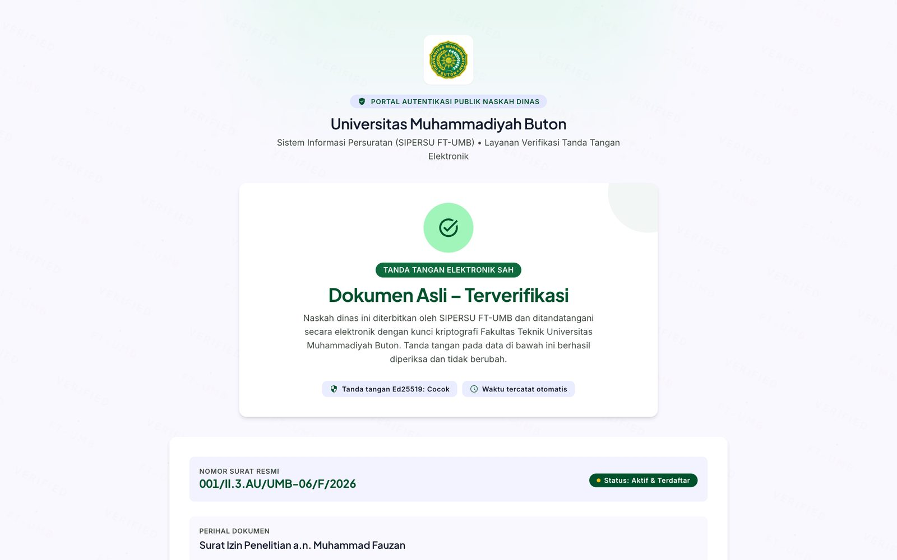

Hasil **tidak valid** berarti data pada QR diubah atau QR bukan dari fakultas. Laporkan ke TU.

**Untuk petugas TU:** halaman verifikasi lengkap (`/v/{token}`, dibuka dari tombol *Verifikasi QR* pada surat) juga menampilkan status aktif/batal dan riwayat dokumen, serta dapat **mencocokkan berkas PDF** yang Anda unggah dengan hash yang tersimpan. Berkas PDF yang diubah satu karakter pun akan tidak cocok.

> QR membuktikan **keaslian dan keutuhan**, bukan kerahasiaan. Isi surat tetap dapat dibaca siapa pun yang memegang PDF-nya.

---

## 10. Bila ada masalah

| Gejala | Penyebab umum | Tindakan |
|---|---|---|
| "Aplikasi ini hanya dapat diakses dari jaringan lokal" (403) | Berada di luar jaringan kampus | Sambungkan ke Wi-Fi/LAN kampus |
| Nama alamat tidak terbuka | DNS lokal belum dikenal perangkat | Pakai alamat IP cadangan; matikan Private/Secure DNS |
| Login ditolak terus | Salah NPM/username atau sandi; atau terblokir 1 menit | Periksa ketikan; tunggu 1 menit; minta TU atur ulang sandi |
| Halaman "Sesi Kedaluwarsa" (419) | Sesi habis (±2 jam tanpa aktivitas) | Muat ulang halaman dan masuk kembali |
| Terlalu banyak permintaan (429) | Terlalu sering mencoba | Tunggu beberapa saat |
| Tombol tindakan tidak muncul | Bukan giliran Anda, atau bukan peran/prodi Anda | Periksa status surat; hubungi TU |
| "Nomor … sudah dipakai surat lain" | Nomor bentrok dengan surat atau catatan Pembukuan | Ganti nomor urut |
| Penandatanganan gagal: nomor belum diisi | Penomoran manual aktif, TU belum mengisi nomor | Minta TU mengisi nomor surat |
| Cetak berbeda dari layar | Peramban menambah header/footer | Matikan *Headers and footers*, margin *None*, atau cetak dari PDF |
| QR tidak bisa dipindai dari luar kampus | Server hanya di jaringan kampus (Fase 1) | Pindai dari jaringan kampus |
| Lupa kata sandi | – | Hubungi TU pada jam kerja |

Bantuan lain: Tata Usaha Fakultas Teknik UM Buton, Senin–Jumat 08.00–15.30 WITA.
